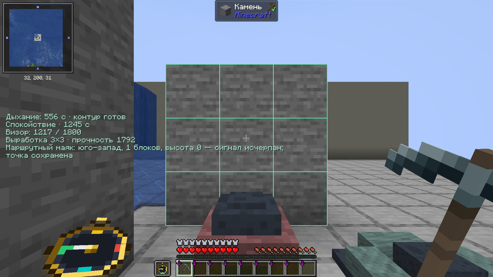
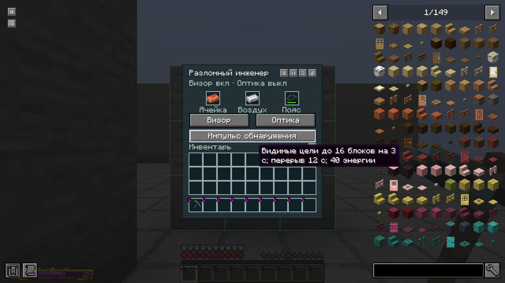

# Разломный инженер: реализация D02

28.10.2026. Локальный кандидат **0.7.0-preview.39-engineer-d02**, внешность **E12**. Разработка находится в основном src. Опубликованная alpha.22 / sequence22 / preview.38-clock-grip прежняя; эта работа ещё не доставлялась игрокам.

## Что работает

| Узел | Реализованное поведение |
|---|---|
| Материал | Защита 4/8/7/3 = 22, твёрдость 3,5 на часть = 14, сопротивление отбрасыванию 0,08 на часть, зачаровываемость 22. Прочность 495/720/675/585. Дополнительного здоровья и общего снижения урона нет. |
| Физические свойства | Шлем: кислород +1; поножи: скорость +8% от базы; ботинки: высота шага +0,5 и урон падения −35%. |
| Химическая подкладка | Укус и плевок местного паука: −6% на часть, до 24%. Только полный исправный комплект получает 60% аварийной защиты от контакта с нижним морем; общий предел с «Защитой разлома» — 60%. Урон и износ остаются. Верхнее море, нагрев лавой и введённый яд опасны. |
| Дыхание | Настоящая сменная кассета на 600 секунд в нагруднике, исправные шлем и нагрудник. Батарея не нужна. Под водой расходуется один тик запаса за реальный тик опасной среды; пересекающиеся обработчики не умножают расход. Чистый воздух запас не расходует. |
| Воздух игрока | Контур удерживает существующий ванильный запас. Надевание, замена кассеты и повторный вход не выдают свежие лёгкие. После опустошения кассеты обычное утопление продолжается. Реальное Водное дыхание не расходует кассету. |
| Дальнейшие атмосферы | Явное событие EngineerBreathing.MediumEvent и тег урона interstice:engineer_inhalation. Сторонние вакуумные/газовые системы автоматически не поддерживаются. Тег по умолчанию пустой. |
| Балласт | В нагрудник устанавливается один настоящий балластный пояс. Выбирается один пригодный пояс в руке либо в креплении; множитель 0,62 не перемножается, износ получает только выбранный предмет. Сохраняются его прочность и неполный счётчик активной секунды; полный пояс рассчитан на 240 активных секунд. |
| Визор | Шлем работает отдельно от остальных частей. HUD показывает фазу/таймер прилива, в Междуморье — расстояния до морей через GeometryProfile, заряд, прочность и режим инструмента, известную маршрутную точку. Механический запас дыхания виден даже с пустой батареей или выключенным визором. |
| Диагностика | При наведении на поддерживаемые собственные машины: состояние, топливо и прогресс реторты, топливо маяка, занятые крепления лебёдки, состояние/топливо/целевая высота подъёмника. Выход, заблокированный у реторты, отражается штатным состоянием машины. |
| Инструменты | Контур настоящей доступной области 3×3 для кирки, лопаты и мотыги использует общую с сервером проверку пригодности. Shift отключает область. В клиенте блоки не ломаются; окончательное разрешение защиты проверяется сервером при работе. Для валки топором квадратный контур не выдаётся. |
| Оптика | Переключаемое ночное зрение, которое не записывает виртуальный эффект в карту настоящих зелий и не удаляет их. |
| Импульс | Серверная проверка видимых живых целей до 16 блоков, подсветка на 3 секунды, перерыв 12 секунд, стоимость 40. Нет поиска сквозь стены, в незагруженных чанках и другом измерении. На клиенте повторно проверяются UUID, измерение, дальность и видимость. |
| Ячейка | Настоящий сменный предмет ёмкостью 1800. HUD расходует 1/с, HUD с оптикой — суммарно 2/с. Внешние миры не дают заряд. Учёт на сервере в тысячных долях, без выдачи энергии за офлайн и смену измерения. |
| Самозарядка | В семействе Междуморья: 0,5/с фоном, дополнительно до 2,5/с пропорционально силе открытого SURGE. Бонус исключён под укрытием, в жидкостях, при лазании, пассажиром и с элитрами. Фоновая зарядка работает с выключенным визором. Максимум 3/с и 1800 в ячейке. |
| Зачарования | Обычные подходящие зачарования брони, «Защита разлома» и «Твёрдый шаг». Починка восстанавливает физическую прочность; дыхательная смесь и электрический заряд — отдельные данные. Дополнительно реализовано Согласование I–III: −10/20/30% затрат энергии с минимумом 1 на положительную секунду/действие. |

## Получение и обслуживание

Это самостоятельная средняя ветка после рифтстальной химии и базовой электроники, до Магена. В кузнечном столе: соответствующая **броня из разломного серебра** + монтажный комплект + нейроадаптер для шлема / один рифтстальной слиток для остальных частей. Боевой рифтстальной комплект не расходуется. Имя, износ, зачарования и посторонние данные основы сохраняются штатным smithing transform.

Состав монтажного комплекта, нейроадаптера, ячейки и кассеты точно соответствует D02. Новая ячейка пустая, новая кассета содержит 600 секунд. Критический путь не требует эхо-осколка, незерита, звезды Незера, сердца моря, безднового сплава или блока управления Магена. Журнал открывает материалы после рифтстали/печатной платы, улучшения — после монтажного комплекта. Рецепты доступны и без поиска шаблона в руинах.

Перезаправка возвращает один существующий предмет с сохранением имени и посторонних данных:

- Опустошённая ячейка + фосфоритовая биопаста + 2 красной пыли → та же ячейка, 1800 заряда.
- Опустошённая кассета + чистая витриолитовая облицовка + древесный уголь + фосфоритовая биопаста → та же кассета, 600 секунд. Эта химия обслуживания выбрана при реализации оставленного в D02 проектного пункта.

Реагенты и входной модуль оплачиваются настоящим крафтом; второго бесплатного модуля не возникает. Частично заполненные модули не принимаются рецептом перезаправки. Весь ресурс остаётся на физическом предмете при переносе, сохранении и загрузке.

## Управление

Наденьте шлем или нагрудник и откройте **«Визор» в инвентаре**. Три настоящих гнезда принимают ячейку, кассету и пояс. Перенос мышью и Shift использует обычные серверные операции контейнера. Ячейку и кассету также можно установить ПКМ в свободное гнездо надетой части. В меню находятся переключатели визора, оптики и кнопка импульса.

В настройках клавиш есть «Импульс визора / Shift: настройки». По умолчанию клавиша не назначена: распространённые клавиши пакета уже заняты. После назначения обычное нажатие даёт импульс, Shift с этой клавишей открывает меню. Состояние надетой брони синхронизируется и при открытом меню модулей.

## Проверки и ограничения

Пройдено **79 различных компонентных проверок**: 17 финальных инженерных, 43 проверки прогрессии/прежней брони/инструментов и 19 проверок снаряжения. Предыдущие 15 инженерных проверок повторно в сумму не включены. Искусственный GameTestServer использует документированное исключение без DH; настоящий полный клиент загрузил DH 3.3.3 и 106 модов.

Полный клиент подтвердил настоящие C2S/S2C меню и импульс, отсутствие цели за стеной, перенос одной физической ячейки, виртуальную оптику без удаления реального зелья, дыхание при нулевой батарее, исчерпание кассеты без восстановления лёгких, диагностику реторты/известной точки и девять общих с сервером клеток предпросмотра. Под водой прежний воздух остался 73; за 60 тиков потрачено ровно 60 тиков кассеты.

В отдельной JVM **12500 → 27780** прочитан настоящий сохранённый регион с сундуком: 1234025 тысячных заряда, 11111 тиков смеси, износ шлема 27, пояса 37 и 17 тиков его неполной секунды, имя и неизвестные данные ячейки совпали. Процессы штатно сохранили мир и завершились после проверки отсутствия незавершённой генерации/сохранений.

Все **209 PNG, 12 OGG и прежние модели** побайтно сохранены, включая E12/Blade/TI02. Из 538 прежних runtime-классов 522 прежние; 16 изменены только в перечисленных интеграционных местах, 22 добавлены для инженера. Worldgen, моря, геометрия, фауна и собственные исправления DH сохранены. Генератор ресурсов повторяем; 10 рецептов и отсутствие нового цикла проверены. git diff --check прошёл.

SHA-256 кандидата: **01514f05817099db9e5d9353e171ba4681f1dde9df984d5d93fe34aa4d36cb5e**. [JAR](D:/repos/Minecraft/EREZCRAFT/build/libs/interstice-0.7.0-preview.39-engineer-d02.jar), [полный машинный отчёт](verification/ENGINEER_D02.json).

Исходный D02 сохранён как вход воспроизводимого генератора в art/designs/engineer_D02.json; его старое поле DESIGN_PROPOSAL_NOT_IMPLEMENTED описывает момент составления требований. Текущий статус определяется этим отчётом и реализацией. Генератор tools/build_engineer_d02.py вызывается также из общего генератора брони; tools/verify_engineer_d02.py сверяет рецепты, повторяемость, архив кандидата и границы изменений.

Это проверка подготовленных отдельных сцен. Естественный Survival, окончательный баланс и многопользовательская ёмкость на 10 игроков отдельно не приняты. Необязательный будущий лут руин и адаптеры чужих атмосфер не добавлялись. Пользовательские миры и настройки не использовались, рабочий сервер не перезапускался, резервные копии не создавались.
