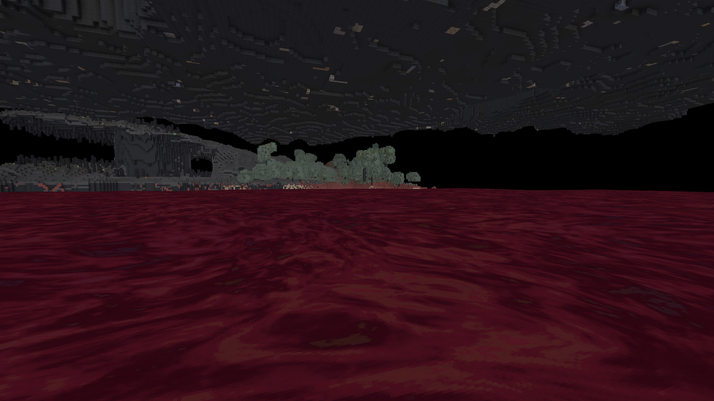
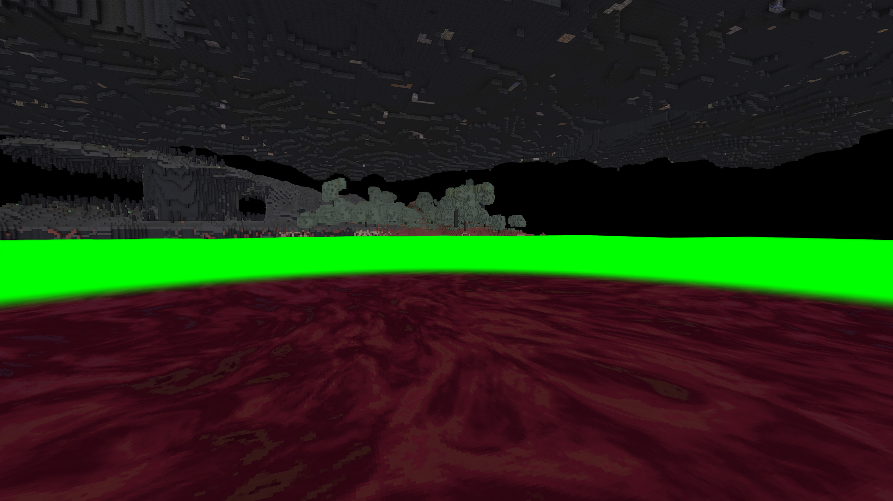

> 29.10.2026: готовые изменения этого документа вошли в опубликованную alpha.23 / sequence23 / preview.98. Сервер healthy, доставка лаунчера проверена; подробности в [STUDIO_UPDATES_RELEASE.md](STUDIO_UPDATES_RELEASE.md). Нижележащие кандидаты — история разработки.

# Нижнее море: единый OC01 в DH

28.10.2026 — кандидат **preview.49-ocean-dh-neoforge**. SHA256: 281752f4bdc3d9ed88bfae295898b76c1e65818e869d2823359795d156cae332.

Ближняя поверхность и дальние полигоны DH в настоящей V6 используют один живой анимированный спрайт Minecraft interstice:block/heavy_oc01, общий мировой период64 блока и одну фазу анимации. Ранее DH показывал плоский красный цвет. Отдельная метка нижнего токсина сохраняется на уровнях детализации DH; обычные материалы сохраняют прежние настройки текстурирования.

Первый кандидат47 не применял параметры атласа: адаптация подключалась к общему классу DH, а NeoForge использует отдельный GlDhTerrainShaderProgram_neoforge. Исправлено подключение именно к нему. Сторонний JAR и PNG не меняются. Геометрия, высота морей и данные мира сохранены; разница высоты верхней грани жидкости и LOD компенсируется только в фазе UV.

Полный клиент с DH3.3.3, Sodium, Iris (шейдеры OFF), Create и Sable,106 модов: PASS. Сохранённая отдельная сцена V6,289 явно загруженных FULL-чанков, фактическая ближняя дальность3 чанка. Маска GPU подтвердила 179222 дальних пикселя с новым материалом, 179107 после reload ресурсов и 176548 после перемещения камеры. Проверен фактически выбранный NeoForge-рендерер. На просмотренных кадрах красная однотонная полоса исчезла. Это визуальная/интеграционная проверка, не Survival или нагрузочная приёмка сервера.

Сравнение с preview46: **1558 ресурсов/data и 583 прежних классов побайтно сохранены**; добавлены7 классов адаптации и записи client mixins. [Машинный отчёт](verification/LOWER_OCEAN_DH.json).

**Граница поддержки:** единый OC01 подтверждён для стандартного рендерера DH без shader pack. В Complementary остаётся прежний дальний цвет: его отдельная shader pipeline не адаптирована к общему атласу. Эта проверка не означает, что стык исправлен с включённым Complementary.

Профиль .verification/oc48n2/studioLowerOceanDh передан владельцу для осмотра и больше не является автоматической фикстурой. Запуск: tools/OpenLowerOceanDhReview.ps1; проверяет успешный отчёт, не запускает второй Minecraft и ставит защитную отметку профиля. Тестовый resume отказывает после этой отметки. Остальные пользовательские профили и миры не использовались.

Холодное открытие той же сцены в режиме просмотра также прошло: DH загружен, player_has_control=true, процесс14216. Профиль оставлен открытым владельцу.

**Прод alpha.22/sequence22/preview.38 прежний.** Внешний вид без шейдеров одобрен владельцем28.10.2026 по его кадру. Публикация49 ещё не выполнялась. Сравнительные замеры производительности старого и нового DH-материала не проводились; равная стоимость не подтверждена.
