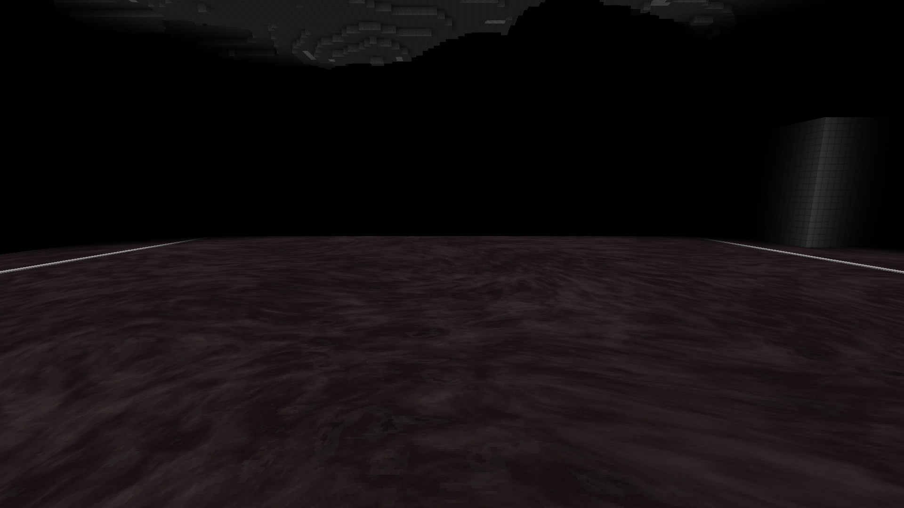
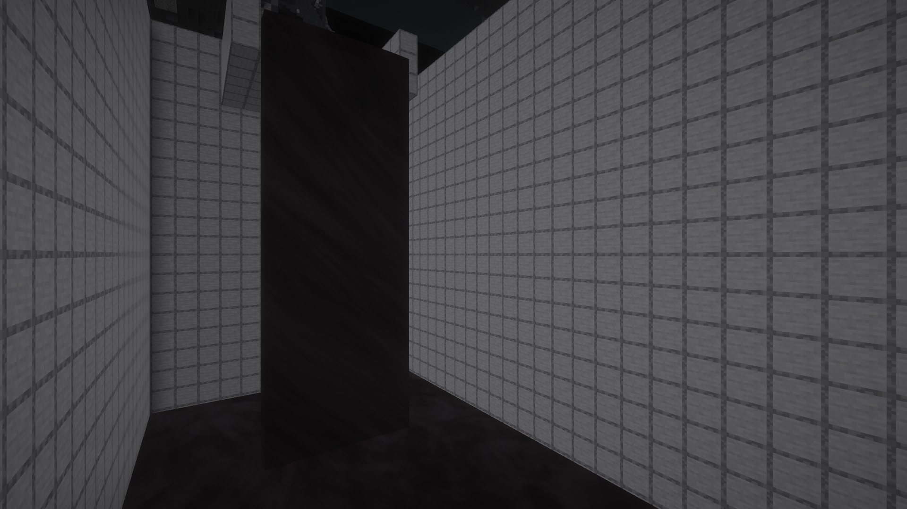

# Проба нижнего токсина OC01 — 28.10.2026

Кандидат **0.7.0-preview.43-lower-ocean-oc01**, SHA-256 **9ab605efda24cd77fcad20b383cdd877cd277975dd62c6bc77a92d74b5d0a5ec**. Материал перенесён и испытан локально в настоящей V6: большое неподвижное озеро, естественный канал и падение в бассейн. Техническая проверка прошла; окончательная оценка цвета и вида потока остаётся открытой. Прод **alpha.22 / sequence22 / preview.38** и профиль владельца не обновлялись.

## Что перенесено

Авторский проект Blender26, OC01:143 узла, мировое поле с периодом64 блока и циклом16 секунд. Сохранённая сцена повторно открыта отдельным Blender5.2.2 без сохранения/модификации. Материал использует мировые координаты; концептуальная иллюстрация не стала текстурой.

В [art/materials/lower-ocean-oc01](../art/materials/lower-ocean-oc01/) сохранены параметры, скрипт и16 исходных unlit-кадров640×640. Все исходные PNG совпадают с Blender. Упаковщик копирует каждый кадр четырежды в1280×1280, сохраняя каждый RGBA-пиксель;640 исходных пикселей покрывают64 блока. Minecraft интерполирует16 ключевых кадров за320 тиков. Это цветовая проба с дискретизированной анимацией; шероховатость, bump, отражения и студийный свет Blender не переносились.

Новые адаптеры меняют только UV существующих граней тяжёлого токсина. Общее поле X/Z с непрерывным срезом по высоте применяется к неподвижной поверхности и каскаду. Дублирование тайла даёт запас для пересечения периода внутри наклонного квадрата. Позиции вершин, высоты, нормали, свет, цвет вершин и отсечение граней остаются штатными. Нового свечения нет. Верхнее море, генерация, урон и физика жидкости не менялись.

## Что проверено в игре

[Машиночитаемый отчёт](verification/LOWER_OCEAN_OC01.json) содержит исходники/хеши, все попытки, измерения и10 неизменённых кадров1920×1080.

- Полный клиент:106 модов, обязательный DH3.3.3, Sodium0.8.13 и Iris1.8.14-beta.1; фактическая dimension interstice:islands_v6 и генератор revision6.
- Подготовленное озеро96×96 блоков на штатной отметке нижнего моря:9216 источников. Это отдельная тестовая сцена, не Survival-прохождение.
- Источники наY52 сами растеклись по каналу и упали в бассейн наY34. Насчитано138 текущих блоков, включая102 падающих наY35..51. Состояния падения не рисовались и не подставлялись вручную.
- По896 выборочных проверок исходных повторённых пикселей до/после reload;18 общих рёбер на отрицательных координатах и границах16/64 блоков для LEGACY128 и TALL256. Фаза совпадает с точностью выборки.
- Настоящий Sodium обработал175307 квадов без изменения защищённых атрибутов; также вызван настоящий vanilla-тесселятор. Ошибок геометрии/света/нормалей —0.
- Два разных CRC участка настоящего GPU-атласа подтверждают обновление анимации. Перезагрузка ресурсов прошла.
- Оригинальный Complementary Reimagined r5.9.3 включён и проверен без Iris fallback/ошибки компиляции, адаптация материалов V6 активна. Фактический uniform ночного зрения камеры равен1. ZIP шейдера побайтно совпадает с исходным.
- Шесть тестовых чанков каскада удерживались активными только для стенда. Перед выходом загрузка снята;1521 chunk holder проверен, незавершённых генераций/сохранений нет. Процесс завершился кодом0,297.34 с.

Наблюдаемый FPS в этих ракурсах43–58 при ограничении60 на RX6800XT. Это отдельные показания, а не сравнение производительности с прежней текстурой или замер ёмкости сервера. Принудительная подготовка большого бассейна вызвала один длинный серверный тик; её нельзя считать обычной игровой нагрузкой.

## Визуальный результат

Крупный рисунок проходит через блоки и чанки без заметной мелкой сетки. Источники и текущая жидкость используют одну фазу и цикл. На каскаде материал выглядит более тёмной и однородной лентой. С корректным ночным зрением цвет в текущем игровом освещении заметно приглушён относительно исходного unlit-кадра Blender. Насыщенно-красный пиксельный классификатор не выделил материал в shader-кадрах; это сохранено как измерение, а не переименовано в подтверждение точного цвета. В отчёте приведены средние RGB и контраст отдельных областей.

Точные исходные пиксели не осветлялись и не перекрашивались для компенсации. Совпадение игрового цвета/глянца со студийным рендером не заявляется. Детальная текстура дальних DH LOD не проверена; проверено присутствие и работа DH в клиенте. Рисунок живёт в общем мировом поле, отдельного переноса узора по вектору скорости жидкости пока нет. Это ограничения текущей пробы, а не завершённая визуальная приёмка океана.

Без ночного зрения полная темнота V6 сохраняется. Во время включения Iris Flywheel переключился с indirect на off; движение механизмов Create/Sable в этой сцене не проверялось.

Озеро, ночное зрение, без шейдера:

Настоящий каскад с Complementary и ночным зрением:

[Крупный план через границы чанков](verification/lower_ocean_oc01/lower-ocean-chunk-edge-detail.png) · [канал](verification/lower_ocean_oc01/lower-ocean-flowing-channel.png) · [озеро с Complementary](verification/lower_ocean_oc01/lower-ocean-shader-wide-still.png) · [полная темнота](verification/lower_ocean_oc01/lower-ocean-darkness-no-night-vision.png).

## Исправленные проблемы проверки

Первый запуск выявил ошибочный вызов getNormal(int) в новом адаптере Sodium; он исправлен на существующий getVertexNormal(int). Второй прошёл технические проверки, но шейдерные кадры были слишком тёмными: Iris читает ночное зрение у камеры, а прежняя ArmorStand-камера его не получала. После исправления камеры третья попытка выявила паузу каскада вне области активной симуляции при перемещении игрока за камеру. Итоговый четвёртый запуск удерживает только шесть собственных тестовых чанков, измеряет настоящий uniform Iris и освобождает чанки перед выходом. Неудачные попытки сохранены в истории отчёта.

## Сохранность и продолжение

Относительно проверенного preview.42 сохранены побайтно562 прежних класса, все693 файла data/,212 PNG и12 OGG. Единственный изменившийся прежний класс — FluidClient$Appearance с двумя путями тяжёлой текстуры; также изменены версия в metadata и список клиентских mixin. Добавлены адаптеры, один PNG/metadata и происхождение OC01. Пауки, инженер D02/E12, инструменты и механики океанов прежние.

Обзор остальных новых проектов: [Ложнокорень, «Скат», OC01 и финальный BN01](BLENDER_EXPERIMENTS.md). Следующий визуальный вопрос — приглушение палитры и характер падающего потока; исходник Blender сохраняется эталоном. Публикация и установка в пользовательский профиль этим поручением не выполнялись.

Очистка промежуточных профилей oc43n1–3 была отклонена автоматической проверкой безопасности (blocked by policy, без дополнительного объяснения). Они пока сохранены в .verification; итоговый стенд — oc43n4. Повторный обход блокировки не выполнялся. Это одноразовые тестовые профили, резервные копии пользовательских миров не создавались.

Обновление28.10.2026: владелец положительно оценил вид OC01. Текстура входит в локальный preview.44 вместе с Ложнокорнем; публикация всего пакета ожидает его ручного теста монстра.
