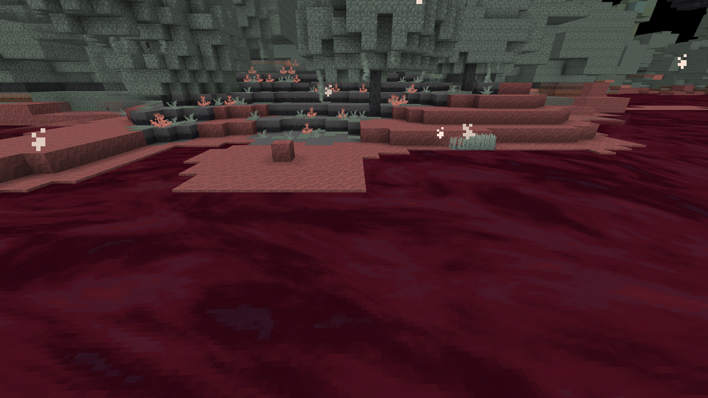
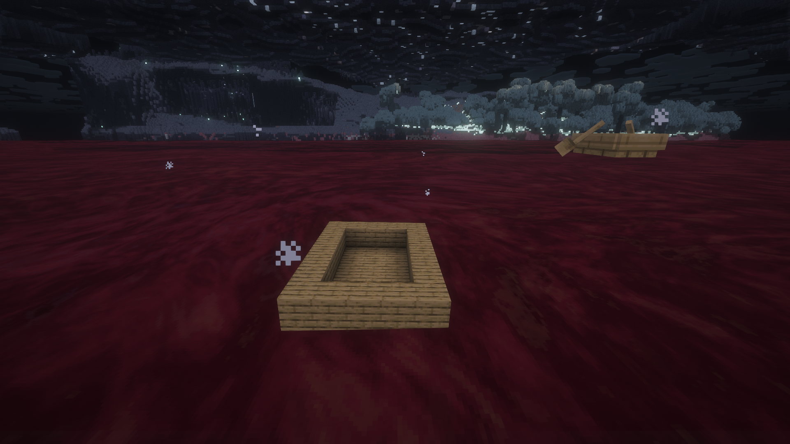

> 29.10.2026: готовые изменения этого документа вошли в опубликованную alpha.23 / sequence23 / preview.98. Сервер healthy, доставка лаунчера проверена; подробности в [STUDIO_UPDATES_RELEASE.md](STUDIO_UPDATES_RELEASE.md). Нижележащие кандидаты — история разработки.

# Нижний токсин: волны, транспорт и берег

29.10.2026. **preview.61-toxin-waves реализован и проверен локально. Визуальное принятие владельцем и серверные проверки ещё открыты.** Прод остаётся alpha.22 / sequence22 / preview.38-clock-grip. Сборка49 с общей текстурой OC01/DH была принята отдельно; это не приёмка новой физики.

## Требования владельца

Волны плавно заканчиваются у берегов и возвращаются к спокойному уровню. Пены и утверждений о неизвестной вязкости нет. Наши суда Sable/Create Aeronautics устойчивы к коррозии; обычные лодки и плоты из любого материала держатся временно и растворяются за200 контактных тиков. Закрытый корпус должен исключать токсин из своего отсека; пробоины должны допускать жидкость.

Частичный природный ориентир — красная кислая вода Рио-Тинто: соединения железа и средний pH около2 описаны [NASA](https://science.nasa.gov/earth/earth-observatory/spains-stained-river-147459/). Это не доказательство состава, плотности2400, вязкости или универсальной десятисекундной коррозии нашего токсина. Последняя остаётся игровым свойством.

## Реализация

- Общая детерминированная поверхность LowerToxinSurface: три направленные вертикальные гармоники, суммарная амплитуда не более0,42 блока, пространственный период4096 и временной1920 тиков. Средний уровень берётся из GeometryProfile. Волны ограничены открытой естественной поверхностью нижнего моря настоящей V6; ведра, течения и верхнее море не превращаются в океан.
- Четырёхблочное затухание у берега/низких перекрытий: smoothstep от расстояния до закрытой ячейки. Карта кэшируется, ограничена512 участками на мир. Клиент и сервер работают со своими мирами в своих потоках. Чтение ячеек использует загруженные чанки без генерации. Незагруженный сосед не считается берегом на границе DH. Изменения блоков и загрузка/выгрузка чанков инвалидируют затронутый участок и соседей.
- Ближняя поверхность: статическая сетка по одному блоку на GPU, четыре обновления участков за кадр, отсечение вне кадра. Двигается шейдером по времени, без chunk rebuild каждый кадр. Дальний DH использует ту же функцию поверхности и живой атлас OC01. Карта берега на GPU — кольцевая R8-текстура1МиБ.
- Sable: силы внутри физического подшага, фактические масса/скорости/поза и координаты хранения корпуса. Штатная плавучесть сохраняется; поправка соответствует разнице погружённого объёма у волновой и плоской поверхностей. Полностью сухие/погружённые блоки не получают этой поправки. Корабль не телепортируется.
- Сухой отсек: консервативная проверка полнотелых блоков дна/бортов, затем проверка той же карты сухих ячеек в шейдере жидкости. Клиент строит их по уже синхронизированным блокам; сервер использует ту же проверку для контакта/глаз/коррозии. Обновление после перестройки — до10 тиков. Автоматическое распознавание ограничено65536 ячейками, размером128×32×128 и шестнадцатью ближайшими судами для GPU-маски. Атлас сухих ячеек —8МиБ; он обновляется при перестройке, а движение меняет матрицу координат. Дополнительных проходов сцены нет. Неполные блоки не считаются герметичными. Это маска отсека, а не симуляция накопления и перетекания массы жидкости внутри судна.
- Обычные Boat/ChestBoat и плоты получают настоящую вертикальную плавучесть на поверхности. Крен модели следует нормали; их коллайдер остаётся штатным осевым коллайдером Minecraft. Полный физический крен относится к Sable. Износ суммарный, пауза на суше не ремонтирует лодку; NBT и предмет сохраняют значение. При200 тиках пассажиры высаживаются на месте, содержимое сундука освобождается, корпус не выпадает. Для самостоятельных реализаций транспорта предусмотрен тег interstice:corrodible_boats; неизвестные типы требуют адаптера.

## Проверка и доказательства

[Полные результаты](verification/LOWER_TOXIN_WAVES.json). JAR SHA256: 3358699b37f6df3450eb39df762e06fa1bac22f8a95754e1a8c224f21828ffa9.

- Семь компонентных GameTests: границы/период/производная волн, девять материалов лодок/плотов, сухая пауза и сохранение износа, сундук/пассажир без дублирования корпуса, обычная вода, герметичность и боковые/донные пробоины, нулевая поправка сил вне ватерлинии.13 покрытых тестами классов побайтно прежние относительно прогона57. Искусственный GameTestServer без DH использован только по исключению AGENTS.md.
- Настоящий клиент V6 с DH/106 модами:188229 дальних фрагментов; материал сохранён после resource reload и движения камеры.952 угла плавного затухания берега. С Complementary —150966 дальних фрагментов; проверяются непрозрачный и водный DH-проходы, поскольку нижний токсин непрозрачный.
- Настоящее судно: масса27,5, высота34,55–35,25, крен до3,15°.15 сухих ячеек согласованы клиентом и сервером. Реальная пробоина впускает токсин, ремонт снова замыкает отсек. Обычная лодка растворилась при200 контактных тиках.
- OpenGL-регрессия проверила загрузку береговой и корпусной карт при изменённых UNPACK/PBO и восстановление состояния без GL-ошибок. При выходе текстуры освобождаются. Основной процесс30660 завершился с кодом0. [Контракт pixel storage](https://wikis.khronos.org/opengl/GLAPI/glPixelStore).
- Холодный процесс34544 восстановил73 тика износа, выдержал160 сухих тиков без изменения, затем продолжил до200. Судно восстановило массу27,5 и15 сухих ячеек; выход0. Дополнительный поиск береговой камеры в том процессе не прошёл: он требовал сплошного берега на уровне жидкости. Проверка сохранения выделена отдельно; исправленный поиск и береговой осмотр выполнены процессом18744 без повторения коррозии, выход0. Исходные результаты сохранены в JSON.
- Сравнение с принятой сборкой49:1443 прежних файла assets/data,214 PNG и136 классов worldgen/geometry побайтно прежние. Исходный Complementary ZIP не перепаковывался.

## Производительность

RX6800XT / i7-10700 /1920×1080, vanilla RD3, ограничение60FPS. Две последовательные выборки347–351 полных GPU-кадров, включая DH. Сравнивается текущий рендер с отключённой и включённой волной; настройки графики между выборками не менялись.

| Показатель | Плоская поверхность | Волны |
|---|---:|---:|
| GPU p50, мс |2,847|3,091|
| GPU p95, мс |2,929|3,134|
| CPU рендера p50, мс |1,716|1,663|
| Кадр p50, мс |16,678|16,678|
| Кадр p95, мс |27,762|28,587|

Прибавка GPU p50 около0,24мс. Это не полный benchmark старой сборки49 и не доказательство одинаковой нагрузки на любых ПК. Dedicated server и ёмкость на10 игроков не измерены.

## Осмотр

Запуск: tools/OpenLowerToxinWavesReview.ps1. Он требует положительных игровых доказательств и чистого выхода этапов, запрещает второй Minecraft и помечает профиль как пользовательский. **После передачи .verification/wv54n1/studioToxinWaves неприкосновенен для автоматических тестов.** Береговая камера36,5 /37,39 /−17,5; контрольное судно около43 /35 /14.

Владелец ещё должен оценить результат. Dedicated server с двумя клиентами, естественный Survival и ёмкость реального сервера остаются открытыми; публикация — после визуального осмотра.

