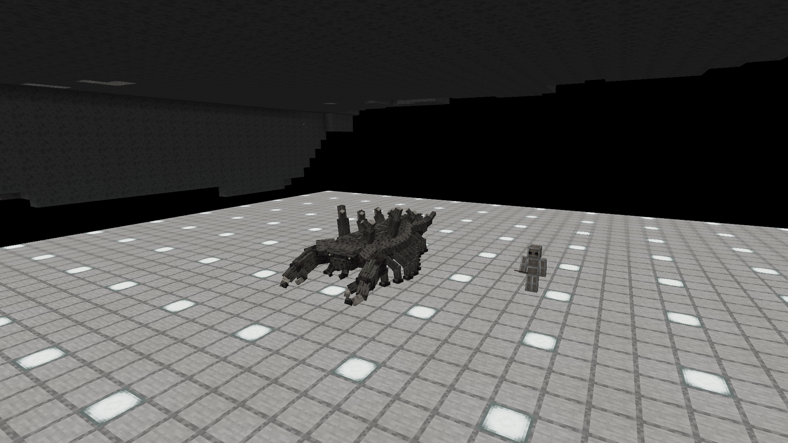
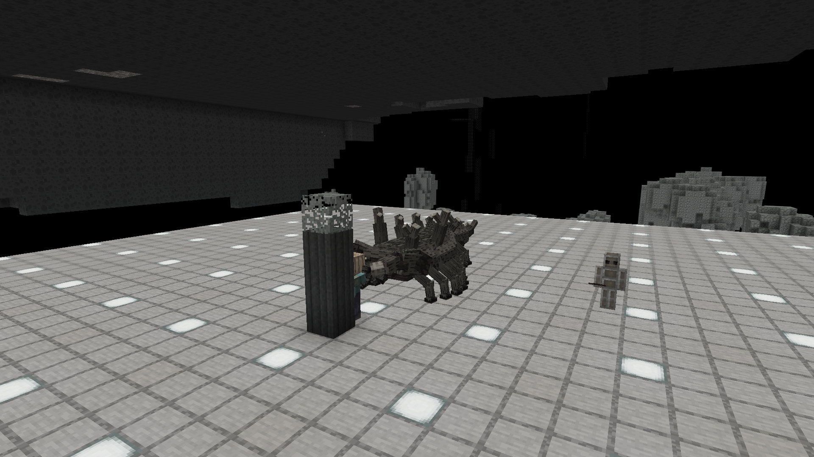

> 29.10.2026: готовые изменения этого документа вошли в опубликованную alpha.23 / sequence23 / preview.98. Сервер healthy, доставка лаунчера проверена; подробности в [STUDIO_UPDATES_RELEASE.md](STUDIO_UPDATES_RELEASE.md). Нижележащие кандидаты — история разработки.

Обновление28.10.2026: [preview.45 — плавные клешни, изгиб корпуса, новый стенд](LOZHNOKOREN_MOTION.md). Ниже сохранена первая интеграция44.

# Ложнокорень LK01

Локальная интеграция проекта24 EREZ Studio. Модель LK01 остаётся эталоном:357 кубоидов,88 суставов,7 исходных16×16 текстур, отдельные Idle/Crawl/Threat. Новое поведение — игровая разработка; в Blender были описаны форма и клипы, а не готовые AI/боевые параметры.

Владелец28.10.2026 поручил добавить иммунитет к обоим морям и местной жалящей флоре, разрушение деревьев/растений во время атаки, большой урон и запас здоровья. Публикация всего подготовленного пакета разрешена только после его ручного визуального теста. До этого сервер alpha.22/sequence22/preview.38 прежний.

## Роль и поведение

Крупный территориальный обитатель нижних лесов, похожий на старый корень. Это редкая тяжёлая встреча на прогалине, не быстрый паук и не обычная толпа зомби. В покое принимает неподвижную авторскую позу; фонового звука нет. Габарит авторского меша около4.33×10.66×3.20 блока. Масштаб не уменьшался для удобства пути.

| Параметр | Текущая первая игровая настройка |
|---|---|
| Здоровье |240, то есть120 сердец |
| Броня |12 |
| Урон хватателями |22 до обычной брони/сопротивления цели; урон не обходит броню |
| Сопротивление отбрасыванию |90% |
| Скорость |Атрибут0.16, преследование65% этой скорости, возвращение50% |
| Зона обнаружения |18 блоков от головы, нужна прямая видимость; невидимая цель не приобретается |
| Скрытное приближение |Крадущийся игрок не привлекает внимание дальше4 блоков от головы; нанесённый удар провоцирует ответ |
| Предупреждение |32 тика /1.6 с: поднимает передние хвататели и голову, раскрывает пальцы |
| Удар |20 тиков; единственная проверка попадания на8-м тике. Направление замаха фиксируется |
| Передний сектор |±35° относительно головы; боковые/задние части тела не наносят контактный урон |
| Дальность |От головы3.1 блока впереди центра — ещё2.15 блока плюс половина ширины цели; высотный предел2.2 блока |
| Восстановление |36 тиков /1.8 с, затем новое предупреждение |
| Ограничение погони |До24 блоков от места обитания, до8 с одной фазы преследования; цель за32 блоками от дома оставляется |
| Потеря видимости |До6 с памяти последней увиденной позиции; скрытое перемещение цели не обновляет эту позицию |
| Удержание |Попавший удар даёт замедлениеII на2 с. Принудительного пассажира/телепорта/неотменяемого захвата нет |

Игрок видит подготовку и может отойти вбок. Удар повторно проверяет сектор, дистанцию, высоту и прямую видимость; каменная стена остаётся укрытием. После промаха есть окно восстановления. Удары по голове передают в общее здоровье125% входящего урона до обычной защиты; остальные секции —100%. Все части используют общий таймер неуязвимости, поэтому одним ударом нельзя снять здоровье за каждую секцию сразу.

AI и урон принадлежат серверу. Клиент получает фазу и время начала через синхронизированные данные. Нет двух одновременно работающих систем целей/движения. Поворот ограничен3° за тик и проверяет свободное место под длинным телом. Если проход закрыт, существо останавливается; оно не пробивает любой материал ради пути и не загружает чанки.

## Моря и флора

Оба наших токсина, их пары и удушение в жидкости не отнимают здоровье. Местные жалящие растения и помеченные споровые облака не дают урон, яд, слабость или замедление. Это точечная адаптация: оружие, огонь, обычные вредные зелья и остальные боевые источники сохраняют штатные правила. Течение и физика жидкостей не отключаются; иммунитет не означает полёт или готовый AI плавания в перевёрнутом море.

## Деревья и растения

Хвататели повреждают растительность только в момент удара, включая промах по увернувшемуся игроку. Фронтальный сектор около головы, до3.5 блока, ограниченная высота; максимум32 блока за удар. Пассивной расчистки, разрушения при ходьбе и бесконечного обвала целого леса нет. Обломки от удара не дают предметов: монстр не становится автоматической лесопилкой.

Разрушаются помеченные местные растения, непостоянная листва и неотёсанные брёвна с естественной кроной рядом. После перебивания ствола дальнейшее исчезновение листвы подчиняется её обычным правилам. Доски, камень, неразрушимые блоки, обычные контейнеры и декоративная постоянная листва не входят в этот список. Для известного Clingweed сделано отдельное разрешение как для растения с block entity, а не общего контейнера.

Обязательны gamerule mobGriefing, событие EntityMobGriefingEvent, разрешение state.canEntityDestroy и неотменённое LivingDestroyBlockEvent. Плагины/моды защиты могут запретить отдельный блок. Дополнительно проверяются граница мира и загруженность чанка. Постоянство происхождения каждого бревна Minecraft не хранит: поставленное игроком неотёсанное бревно под естественной кроной может удовлетворить признаку дерева. Поэтому абсолютная защита любых построек из брёвен не обещается.

## Длинное тело и спавн

15 pickable/collidable-секций:11 участков панциря, голова, два хватателя и хвост. У них последовательные сетевые ID, урон передаётся родителю. Перед движением и поворотом проверяются эти физические оболочки. Они приближают анатомию, не повторяют каждый из357 декоративных кубоидов и каждую мелкую анимационную деформацию сустава. Основной root-box2.4×2.1 блока не выдаётся за полный габарит модели.

Природный спавн вызывается отдельным ограниченным серверным обработчиком только в настоящей V6/revision6: crimson_thickets и pale_gardens, тег forest_floor, сухая отметка выше нижнего моря, свободная анатомическая оболочка и опора под всеми секциями. Нужен живой обычный игрок в32–80 блоках и свободный общий бюджет монстров. На попытку выбирается один игрок; проверка раз в400 тиков, до6 проб мест. Не больше6 живых ложнокорней в мире, рядом с новым местом не должно быть другого в128 блоках. Peaceful, отключённый mob spawning, неактивные чанки, прочие измерения и плотные препятствия исключаются. Генератор и поверхность не переписаны.

В Creative доступно яйцо призыва. Команда: summon interstice:lozhnokoren. До согласования прогрессии добыча временно простая:8–16 палок и35 опыта; новые рецепты/ресурсы автоматически не вводились.

## Сохранение и ресурсы

Сохраняются обычные здоровье/экипировка/состояние моба и домашняя точка. После холодной загрузки цель сбрасывается, начинается безопасная фаза маскировки; удар не доигрывается повторно. Вызов API атаки вне нужного кадра не обходит подготовку.

[Исходник](../art/fauna/lozhnokoren/lozhnokoren_LK01.bbmodel), [происхождение](../src/main/resources/assets/interstice/provenance/lozhnokoren.json), [сборщик](../tools/build_lozhnokoren_model.py), [независимая сверка](../tools/verify_lozhnokoren.py). Все7 RGBA-тайлов повторены в атласе без перерисовки, смены палитры, альфы или размера исходников. Сохранены исходные три клипа. Камуфляж замораживает позу, ходьба использует Crawl, предупреждение — Threat; игровой удар использует возвращение хватателей из этой позы. Отдельного авторского клипа Attack/Death в LK01 нет.

Проверки поведения — LozhnokorenGameTests; визуал, сеть частей, реальная V6, океаны и reload — LozhnokorenNative в полной сборке с DH. Подготовленная сцена не является Survival-прохождением, проверкой ёмкости сервера или субъективным одобрением владельца. [Протокол](verification/LOZHNOKOREN.json):15 обязательных компонентных проверок PASS; два полных клиента с DH/106 модами — PASS. Итоговый кандидат **0.7.0-preview.44-lozhnokoren**, SHA-256 **c75675aff9f350cd1bc39b0a9a2e0675248a38b4d951bca56576302c6a206bc9**. Независимая сверка всех исходных углов дала максимальную ошибку1.47e-14 модельной единицы; исходные UV/RGBA/клипы сохранены.

Во втором клиенте: один настоящий удар снял21.648 здоровья у тестового зомби, сломаны4 блока дерева, существо прошло11.22 блока;159 серверных тиков контакта с HEAVY и123 с LIGHT без урона/эффектов. Пройден настоящий путь регистрации природного спавна с общим бюджетом, расстоянием до обычного игрока, контролируемым лесным биомом V6 и проверкой опоры. Это проверка механизма, не замер естественной частоты встреч.

Третий процесс холодно открыл тот же сохранённый мир: V6/DH,240 здоровья и15 согласованных сетевых ID секций. Профиль **.verification/lk44n2/studioLozhnokoren** теперь передан владельцу: не перезаписывать, не использовать для автоматических тестов и не закрывать его игру. Прежние566 классов,213 PNG,12 OGG и693 data-файла сохранены побайтно; изменены только регистрация, точечные адаптации к токсину/флоре и новые собственные ресурсы. Инженер D02/E12, исправленные пауки и OC01 входят в кандидат.

## Ручной осмотр

Мир **LK01 owner review** уже открыт, игрок в Creative, ночное зрение включено. Ложнокорень рядом с8.5,70,8.5; точка обзора8.5,73,24. В инвентаре незеритовая броня, меч, щит, зачарованные яблоки и яйца призыва. Для боя сначала надеть броню, затем выполнить /gamemode survival. Возврат — /gamemode creative. Дополнительное существо: /summon interstice:lozhnokoren. Повторное открытие закрытого стенда: tools/OpenLozhnokorenReview.ps1; скрипт не запускает вторую JVM поверх работающего клиента.

Сначала оценить силуэт, масштаб возле игрока, хвататели и походку. Затем — предупреждение, уход вбок, урон, восстановление и разрушение растительности. Подготовленная площадка не доказывает маневрирование в густом естественном лесу. Прямое управление ходом пока останавливается у препятствий; полноценного маршрутизатора сочленённого тела и AI плавания верхнего моря нет. Отдельный dedicated-server бой двух игроков и ёмкость сервера ещё не проверялись. Декоративные части тела имеют приблизительные физические оболочки.

Новая публикация всего подготовленного пакета ожидает визуального теста и одобрения владельца.

Обновление46: [исправлены пролетающие рамки F3+B](LOZHNOKOREN_HITBOX_DEBUG.md); новый защищённый профиль владельца lk46n2.
