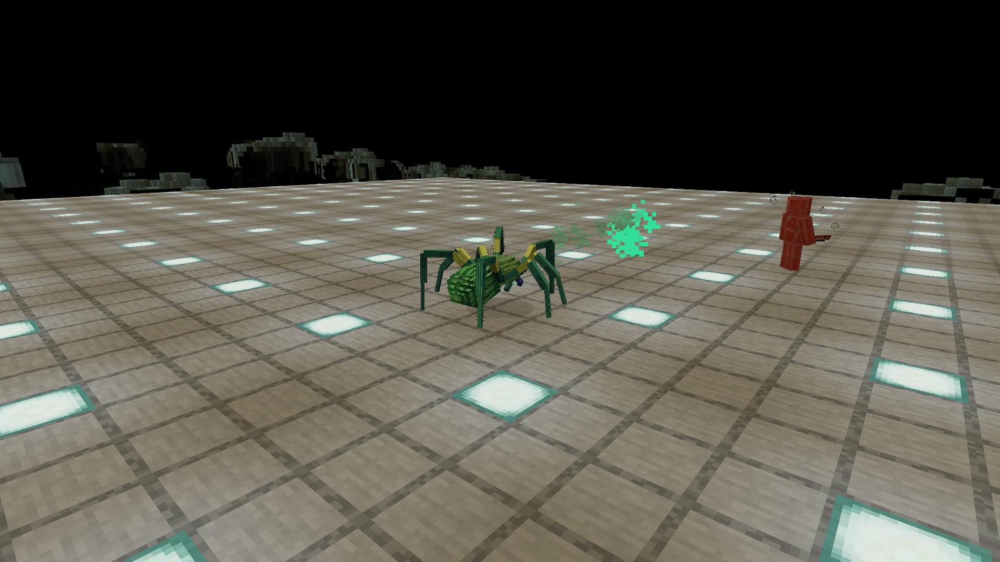
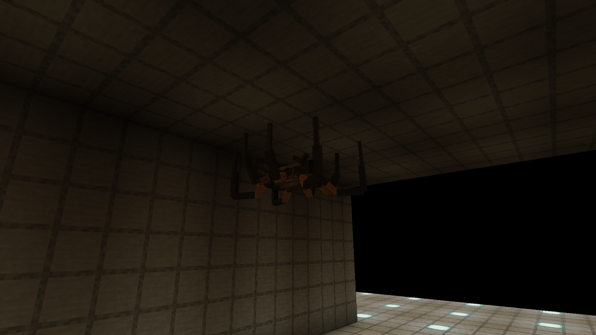
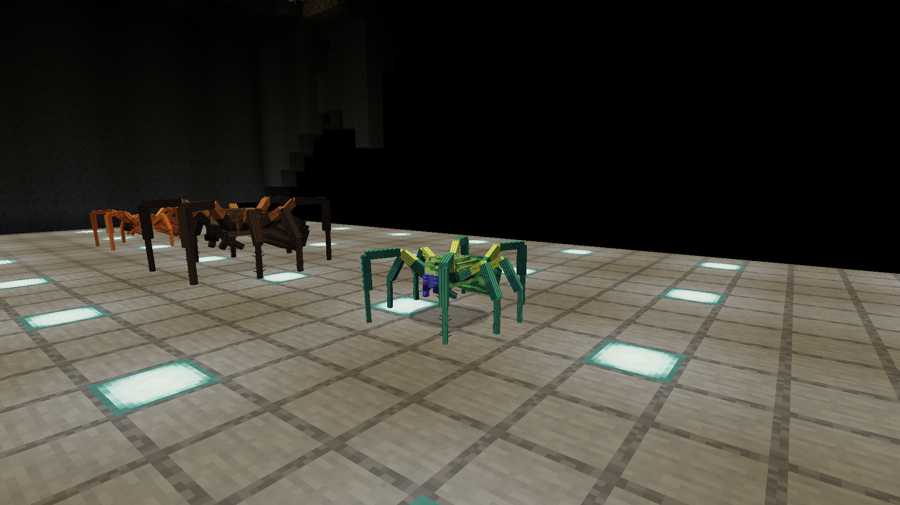
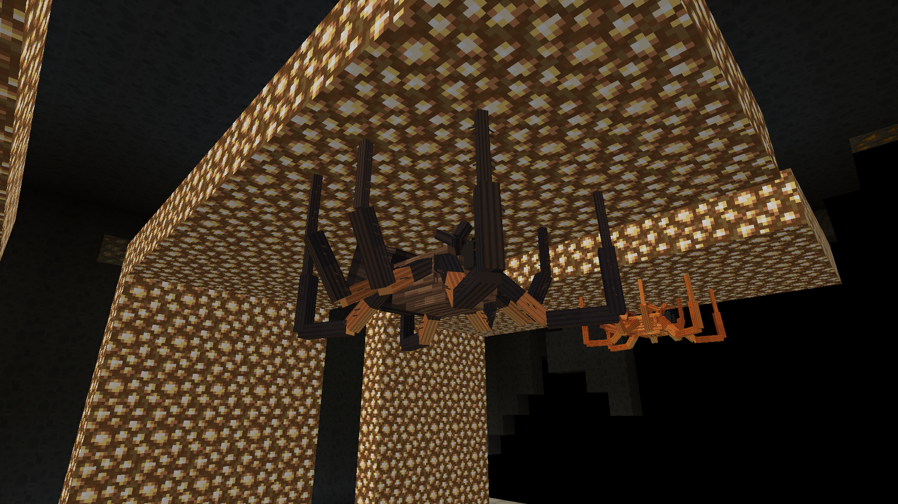

> 29.10.2026: готовые изменения этого документа вошли в опубликованную alpha.23 / sequence23 / preview.98. Сервер healthy, доставка лаунчера проверена; подробности в [STUDIO_UPDATES_RELEASE.md](STUDIO_UPDATES_RELEASE.md). Нижележащие кандидаты — история разработки.

# Пещерные пауки: модели, поведение и бой

## Атаки после разворота — 28.10.2026

**Исправлено и проверено локально:** кандидат **0.7.0-preview.42-frontal-spiders**. Оранжевый и Lurker больше не кусают сбоку или сзади, зелёный не выпускает плевок назад без разворота. Цель должна попасть в передний сектор90° (±45°) в плоскости текущей опоры. Проверка стоит непосредственно в doHurtTarget и performRangedAttack, включая прямые вызовы этих методов. Отказ не наносит урон и эффекты; отклонённый плевок не создаёт снаряд и не расходует38-тактовую перезарядку.

AI плавно поворачивает жёсткий корпус, максимум18° за тик. При активном наведении после довыравнивания с целью до10° выдерживаются3 последовательных тика перед атакой. Во время перехода между опорами атака блокируется до завершения поворота. Направление синхронизируется сервером, и рендер использует тот же вектор; независимый ванильный поворот головы не подменяет направление неподвижной относительно тела морды. Вектор передвижения Azure остаётся отдельным: зелёный может отходить назад, продолжая смотреть на цель. Покой и прежний MOVE сохранены.

Пол, потолок и все4 стены используют собственную касательную плоскость. Цель строго по нормали к опоре не считается находящейся перед мордой; стрелять сквозь брюшко ради неё паук не будет. Полёт уже выпущенного снаряда остаётся самостоятельным: направление проверяется при выстреле, последующий поворот владельца не отменяет честное попадание.

**Проверки:**18 целевых компонентных случаев — блокировка боковых/задних API-вызовов, отсутствие побочных эффектов/расхода перезарядки, математика6 опор и настоящий AI, который разворачивается и затем атакует. Пробы для всех3 вариантов подтвердили попадания только после выравнивания; исходные позиции цели спереди/сбоку/сзади всё ещё достигаются атаками, поэтому исправление не сводится к отключению боя.49 регрессионных проверок охотников/пауков и177 основных проверок, включая прежнюю баллистику/броню/сохранение, прошли. Итого244 различные компонентные проверки; новый набор добавлен в штатный check.

Полный клиент с DH и106 модами, настоящая islands_v6/revision6:30 сценариев,157 проверок, включая55 проверок направления при настоящих укусах и создании плевков — PASS. Преследование, засада/спрыгивание, отступление со стрельбой, укрытие, повторное обнаружение, остановка AI и смерть сохранены. Кадры проверены: видимый корпус обращён мордой к цели. Это отдельный подготовленный профиль с усиленной тестовой живучестью игрока; естественный Survival, сетевая задержка и ёмкость реального сервера не принимаются этим прогоном. GameTestServer по известному исключению работает без DH; настоящий клиент — с DH.

В процессе18-кейсовая потолочная fixture исправлена: более высокий зомби пересекал потолочную плиту, затем добавлена обязательная проверка свободного объёма обоих участников. В первом регрессионном прогоне один раз упала неизменённая проверка непрерывной погони сводника; добавлена телеметрия здоровья/видимости/позиций, повтор49-кейсового набора прошёл без изменения классов сводника. Этот единичный сбой отдельно не воспроизведён; история попыток сохранена в JSON.

Геометрия LS04/SK01/SP02, UV, все212 PNG и12 OGG, хитбоксы, урон/эффекты, баллистика и worldgen сохранены. От preview.41 логика изменилась только в CaveRiftSpiderEntity и CaveRiftSpiderRenderer:559 прочих классов побайтно прежние, ещё2 вложенных класса имеют только сдвиг отладочных строк — код javap совпадает. Проверка воспроизводится через [verify_spider_facing.py](../tools/verify_spider_facing.py). SHA-256 JAR:ac927cb2ace1117ecb17d3577bd942e8d4e7343b04d495a0e17a01b7965594a5.

Прод остаётся **alpha.22/sequence22/preview.38**. Пользовательские профили не использовались; публикация, установка владельцу и резервирование не выполнялись. [Итоговый отчёт](verification/SPIDER_FACING_FIX.json), [native receipt](verification/spider_facing/native-run.json), [углы оранжевого](verification/spider_facing/skirmisher.json), [углы Lurker](verification/spider_facing/lurker.json), [углы зелёного](verification/spider_facing/spitter.json).

## Поведенческие тесты и направление атаки — 28.10.2026

Историческая диагностика preview.41; найденное ограничение устранено в preview.42 выше.

Локальный кандидат **0.7.0-preview.41-spider-behaviour**:64 компонентные проверки (15 фауны +49 охотников/пауков) и полный клиент с DH/106 модами прошли. В настоящей islands_v6/revision6 выполнены30 сценариев и102 проверки,5040 серверных тиков наблюдения. Сценарии: покой с включённым AI, Creative, Spectator, Survival на дистанции и вблизи, закрытое укрытие, повторное обнаружение, отключение AI, возобновление и смерть. Цели и маршруты в нативном прогоне не назначались, атаки вручную не вызывались. Игрок переносился между сценариями, имел1000HP и отключённую гравитацию; это контролируемая сцена, не приёмка естественного Survival.

Подтверждены самостоятельное преследование и укус оранжевого с9 блоков за20 секунд, выход Lurker на потолок без crawlTo и его последующий спрыгивающий удар, отступление/стрельба/смена позиции зелёного. За полностью закрытым укрытием атакуемая личность стирается, скрытое положение не отслеживается, снимок последнего наблюдения истекает; повторное обнаружение работает. Creative/Spectator не атакуются. После NoAI и смерти нет новых атак; после возобновления AI атаки возвращаются. Итоговый прогон:22 созданных плевка,58 событий урона,0 ambient-шипений.

В двух20-секундных наблюдениях доля тиков без движения: оранжевый87.75–98.5%, Lurker87.75%, зелёный86.5–93.5%. Порог движения — перемещение более0.003 блока за тик. В показатель Lurker входит первоначальный подъём на потолок; затем он стоит. Случайные прогулки двух других вариантов сохранены. Эти короткие наблюдения не доказывают суточный ритм реальных птицеедов.

**Найден и исправлен звук:** начало рывка Lurker всё ещё вызывало SPIDER_HURT с громкостью1.3. Отдельный тест воспроизвёл это событие; теперь0.15. Прежняя проверка тишины слушала только AtEntity, тогда как обычный playSound здесь вызывает AtPosition. Измеритель учитывает обе формы и имеет положительный контроль настоящим звуком. Первый native-прогон не прошёл2 слишком широкие проверки общей громкости из-за физических звуков падения на камень. Сырые события сохранены; итоговая проверка раздельно учитывает голос/шаги и приземление. Физические звуки не удалялись ради успешной проверки.

**Отдельная находка по вопросу владельца: у атак нет ограничения по направлению морды.** Три диагностические пробы фиксировали положение и поворот тела, оставляя настоящий AI включённым. Цель обнаруживалась автоматически, атаки запускал AI. В момент реального урона записывались поворот тела/головы и скалярное произведение направления вперёд с направлением к цели:1 — спереди,0 — сбоку,−1 — сзади.

| Вариант | Попадания спереди | Сбоку | Сзади |
| --- | ---: | ---: | ---: |
| SKIRMISHER — укус |2|2|2|
| LURKER — укус |2|2|2|
| SPITTER — плевок |1|1|2|

Диагностические пробы выполнились успешно, но **требование атаки только передней стороной не пройдено**. Текущий укус проверяет дистанцию/видимость, плевок наводится на цель независимо от направления тела. Голова модели не разворачивается отдельно от тела; смотреть нужно на реальную переднюю сторону рендера. Исправление этого ограничения ещё не сделано. Для него нужны поворот перед ударом и проверка направления в момент попадания/выстрела с учётом пола, стен и потолка; данные модели менять не требуется.

От candidate40 изменена только одна runtime-константа громкости;562 прочих классов, все212 PNG и12 OGG побайтно сохранены. Геометрия LS04/SK01/SP02, UV, пиксели, параметры AI, урон, хитбоксы, инженер D02/E12 и генерация прежние. JAR SHA-256:ecaa2a253d56c95d69520490a9645d3387ce0fda90ec1420225a73b791f6e849. Прод остаётся alpha.22/sequence22/preview.38; пользовательские профили не использовались, публикация и резервирование не выполнялись.

[Итоговый машинный отчёт](verification/SPIDER_BEHAVIOUR.json), [полный native receipt](verification/spider_behaviour/native-final.json), [углы Lurker](verification/spider_behaviour/facing-lurker.json), [углы оранжевого](verification/spider_behaviour/facing-skirmisher.json), [углы зелёного](verification/spider_behaviour/facing-spitter.json).

## Модели и спокойное поведение — 28.10.2026

Локальный кандидат **0.7.0-preview.40-studio-spiders** переносит выбранные владельцем **LS04 / SK01 / SP02** из Blender-проекта23. Исходные .bbmodel скопированы побайтно в [art/fauna/erez-spiders](../art/fauna/erez-spiders/). Формы, пропорции, локальные повороты кубоидов, UV, полосатый рисунок и палитры сохранены. Исходные .blend и фотографии не менялись. Масштабы Lurker0.85 / Skirmisher0.60 / Spitter0.55 прежние.

На вариант приходится309 кубоидов,53 кости и1854 четырёхугольника. Прежний Java-конвертер не сохранял242 локальных поворота и разные текстуры граней; новый [build_spider_models.py](../tools/build_spider_models.py) воспроизводит их в ресурсном mesh.22 исходные картинки128×128 упакованы без изменения RGBA-пикселей в атлас512×768. Нативные ModelPart управляют прежними суставами и MOVE; геометрия остаётся жёсткой.

**Исправление поведения покоя:** прежний зацикленный IDLE больше не проигрывается. Нет заметного раздувания брюшка и постоянного шевеления в неподвижной позе; ходьба включается от фактического limb swing, включая движение по стенам и потолку. Удалён периодический SPIDER_AMBIENT, громкость шагов снижена0.15→0.015, событий укуса/плевка и базовая hurt/death —0.15. Старые звуковые файлы сохранены. Это настройка покоя модели и звука; AI, патрулирование, цели, навигация, урон, хитбоксы и боевые интервалы не переписаны.

Изучены дыхание и повадки реальных прототипов:

- Газообмен идёт через книжные лёгкие; диафрагмы млекопитающего нет. Видимая ритмичная «накачка» тела для нашей idle-анимации была неверным ориентиром. [Ask Extension](https://ask.extension.org/kb/faq.php?id=407631).
- **SK01 — Pterinochilus murinus.** Реакции защиты включают бегство, подъём передней части тела и укусы; эксперимент показал зависимость от устройства укрытия. Это не основание для постоянной суеты или беспрерывной атаки. Изучен авторский abstract, не заявляется чтение недоступного полного текста. [Uddin & Arbuckle, Arachnology20(1),25–30](https://cronfa.swan.ac.uk/Record/cronfa69148).
- **SP02 — Ephebopus cyanognathus.** Норный образ жизни взрослых; ранние стадии могут использовать древесные укрытия. В полевых наблюдениях важны возраст и связь с убежищем. [West et al.,2008](https://www.mapress.com/zt/article/view/zootaxa.1849.1.3), [Zamani & West,2026](https://pmc.ncbi.nlm.nih.gov/articles/PMC13106993/).
- У P.murinus пары ног выполняют разные двигательные и стабилизирующие функции; передние также исследуют препятствие. Это ориентир дальнейшей доработки походки, а не заявление, что существующий MOVE уже воспроизводит измеренную кинематику вида. [Nelson, Dasari & Hsieh, SICB](https://sicb.org/abstracts/differential-limb-function-during-locomotion-on-the-level-and-over-obstacles-in-the-tarantula/).

Вид LurkerLS04 в метаданных не указан — не определялся по одному фото. Не утверждается абсолютная бесшумность всех птицеедов: защитные звуки возможны, постоянный ambient-loop убран. Строительство нор, стадии жизни, новые защитные позы и полный этологический AI не реализованы. Фантастические укус/плевок и роли Междуморья сохранены.

**Проверено:** независимая фоновая сверка с3 сохранёнными Blender-сценами —309 кубоидов/1854 грани каждого, совпадают winding и UV, ошибка вершины не более1.41×10⁻⁶ модельной единицы.62 компонентных теста (15 фауны +47 охотников), включая фактическое отсутствие ambient-событий в покое. Два отдельных запуска полного клиента с DH и106 загруженными модами, настоящая islands_v6/revision6: статичная поза, MOVE без изменения масштаба, все3 маршрута пол→стена→потолок, перезагрузка ресурсов и штатное сохранение/выход прошли. Второй запуск использован для обзорных кадров. Искусственный GameTestServer по согласованному исключению запускается без DH; настоящие клиенты — с DH.

SHA-256 JAR: baaf75bcd1220d4d68ab97f23fa26081443786abf179d50473d53962d270c42f. От кандидата39 изменены только3 прежних runtime-класса паука;557 других классов,209 PNG и12 OGG побайтно сохранены. Инженер D02/E12 и worldgen прежние. Эти изолированные сцены не доказывают естественный Survival, баланс или сетевую ёмкость. Пользовательские профили не использовались; прод остаётся alpha.22/sequence22/preview.38. Публикации кандидата40 ещё нет.

[Машинный отчёт](verification/SPIDER_MODELS.json), [native receipt](verification/spider_models/native-run.json), [Blender-сверка](verification/spider_models/blender-mesh-check.json), [исследование поведения](../art/fauna/erez-spiders/behaviour_research.json).

Актуальная механика после отзыва владельца: [FAUNA_FEEDBACK.md](FAUNA_FEEDBACK.md).
Параметры alpha.10 ниже сохранены как история предыдущей проверки.

11.10.2026: исправление по наблюдению владельца — плевок по неподвижной цели
в десяти блоках падал на землю раньше цели. Прямая начальная скорость не учитывала
прежние горизонтальное сопротивление 0.98 и ускорение вниз 0.03 за тик. Прицел
также рассчитывался от другой высоты, чем фактическое начало снаряда.

`ToxinSpitEntity.aimAt` рассчитывает скорость от настоящей позиции снаряда до
центра тела цели. Для времени полёта `n` тиков используется сумма горизонтальных
скоростей `Σ0.98^k` и вертикальное смещение `n*vy−0.03*n*(n−1)/2`. Выбирается
самая короткая допустимая дуга в пределах 40 тиков, скорость не превышает прежнюю
0.85. Наведение после выстрела отсутствует. Каждый сегмент дуги проверяет ту же
геометрию COLLIDER, что настоящий движущийся снаряд; блокированная дуга не
подменяется высоким броском поверх укрытия. Дальность 14 блоков, частота стрельбы,
урон 4, яд/замедление и запрет дружественного огня сохранены.

Укус и плевок уже входят в `minecraft:bypasses_armor`. Это общее правило типов
урона: обычные характеристики ARMOR и ARMOR_TOUGHNESS игнорируются независимо
от namespace предмета. Начальная модовая броня с такими характеристиками не
получает защиты, которой нет у ванильной. Изменять сами предметы или отключать
энергетические щиты позднего снаряжения для этого не нужно. Зачарования,
сопротивление и специальные способности сохраняют действующие правила.

`SpiderCombatGameTests` содержит реальные серверные полёты по неподвижному зомби
в 10/14 блоках и выше/ниже паука, блокирование дуги при сохранённом прямом обзоре,
появление стены после выстрела и экипированную non-vanilla fixture с 20 ARMOR и
8 TOUGHNESS. Последняя сначала подтверждает защиту от обычного удара, затем
полный урон укуса/плевка. Fixture меняет только одноразовый ItemStack внутри
теста; новых production-предметов нет. Компонентная fixture не заменяет проверку
конкретной начальной Ars sorcerer/Mekanism hazmat брони в полной сборке.

Полный build11.10.2026 прошёл453 обязательные проверки. Native-клиент полной
сборки с DH подтвердил попадания на10/14 блоков, Ars sorcerer с11 ARMOR
и Mekanism hazmat: обычный удар ослабляется Ars-бронёй, укус5 и плевок4
сохраняются. Проверка не отключает поздние энергетические щиты. Поверхность V6,
пользовательские миры, естественные spawn-правила и другие существа не менялись.
