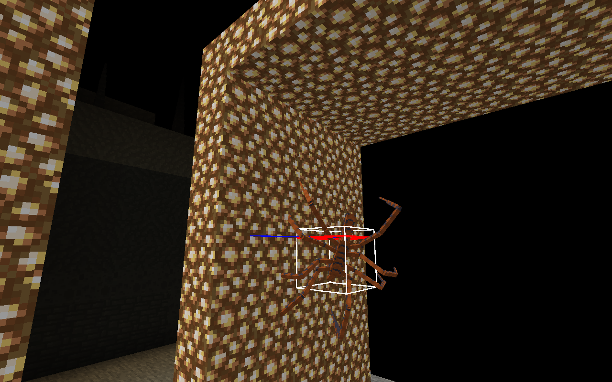
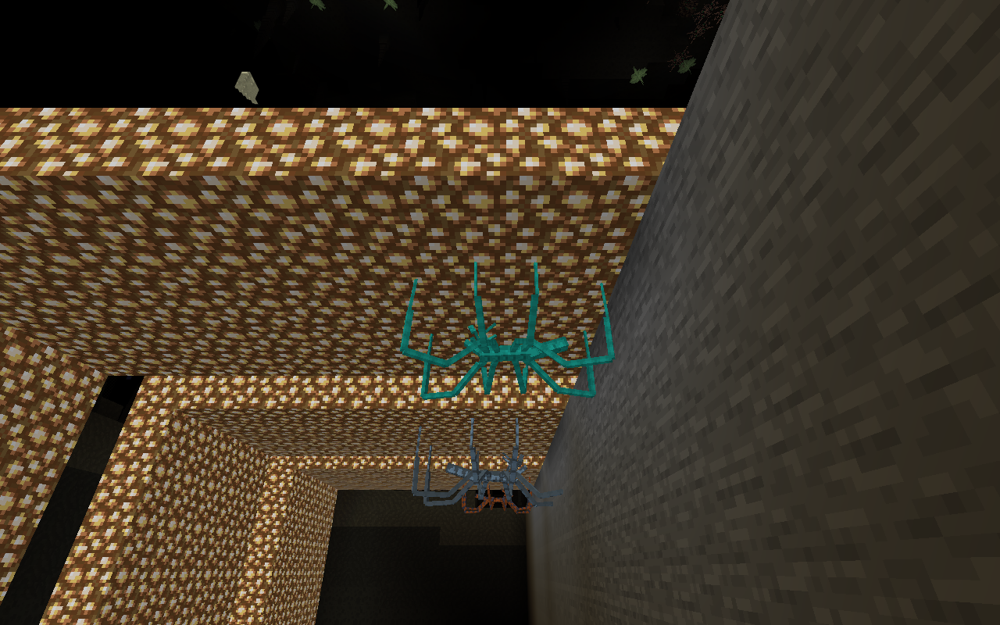

# Пауки: SmartBrainLib и AzureCortex

Локальный кандидат от 23.10.2026 по двум поручениям владельца: перенести решения пауков на SmartBrainLib и попробовать заменить прежний поиск лазания на AzureCortex. **Не опубликован:** рабочий сервер, лаунчер и подписанный модпак прежние. Сохранения владельца не используются для испытаний.

## Что исполняется

`CaveRiftSpiderEntity` реализует `SmartBrainOwner` и `CrawlCapability`. Прежние `SurfaceGoal`, `SpitterRangedAttackGoal`, обычные цели движения/атаки и отдельный выбор противника удалены из активного планировщика. Brain запускает сенсор, Core/Idle/Fight и действия; один Motor владеет наземным движением и лазанием. Стрельба работает независимо от владения движением, в том числе на потолке. Отложенная ближняя атака заново проверяет видимость и дистанцию через 4 тика; интервал начал атак — 20 тиков. Плевальщик не переключается на конкурирующую ближнюю атаку.

В `crawlTo` теперь вызывается `AzureSpiderNavigation`: **оригинальные AzureCortex `IncrementalPathSession`, `CrawlTraversalEvaluator` и `PathNodeCache`**, адаптированные через публичный `TraversalEvaluator`. Скорость к очередной точке вычисляет оригинальный `NavigationQueries.computeWallCrawlVelocity`. Старый локальный A* из `SpiderSurfacePath.find` не вызывается; оставшиеся `clear/clearSegment` проверяют геометрию. Старый кандидат сохранён отдельно для сравнения.

Это **не перенос всего Azure AI и не штатный slim-контроллер без изменений**. Наш адаптер сохраняет физический корпус и синхронизацию ориентации:

- Узлы Azure привязываются к настоящим прочным граням с учётом размеров паука. Обязательны фактическое касание опоры, свободный полный объём и проверка всего перехода.
- Добавлен переход с наземной сетки в первый узел стены через собственные классификаторы Azure: стандартная наземная коробка в центре клетки не позволяет корпусу шире блока войти в такую клетку как обычному пешеходу.
- Стоимость и достижение цели считаются по привязанному полному корпусу. Штатная slim-проверка стоимости не подходит этим координатам. Длинные рёбра Azure разбиваются на шаги ≤0.75 блока; проверка неожиданного смещения остаётся действующей.
- Движение применяется через обычный `Entity.move` и полный хитбокс; `CrawlController.applySlimMovement` с прямым `setPos` не используется. Гравитация/удержание опоры и плавное представление поверхности остаются адаптером EREZCRAFT.
- На запрос — максимум 384 раскрытия Azure A*, диапазон 24 по Manhattan от начала. Это ограниченный синхронный запрос через `step(384)`, а не утверждение о многотиковой фоновой генерации. В обычном AI прежняя FIFO-очередь допускает одного планирующего паука измерения за тик, максимум основной и запасной поиск. Повторы разнесены на 35–44 тика. Запросы к незагруженной области отклоняются до обращения к Azure.

## Различия вариантов

| Вариант | Поведение |
| --- | --- |
| Налётчик | Сначала достижимый боковой обход (3 блока в сторону и 2 вперёд), затем сближение; короткий прыжок с отдельным интервалом 50 тиков |
| Засадник | В спокойствии ищет доступный потолок до 12 блоков выше и ждёт; игрок запускает наземную засаду в пределах 3.5 блока, на потолке — при таком горизонтальном расстоянии и до 10 блоков ниже. При подходе падает с потолка. Ярость 160 тиков, следующий старт не раньше 240: есть 80 тиков обычного темпа |
| Плевальщик | Держит дистанцию, отходит при сближении ближе 5 блоков, подходит с дистанции более 12; стреляет до 14. После удачного выпуска ищет достижимую боковую позицию. Интервал настоящих выстрелов 38 тиков общий для пола/стен/потолка |

Сенсор проверяет текущую цель каждый тик, новую — раз в 5 тиков со сдвигом между сущностями. Учитываются невидимость, союзники, Creative/spectator, смерть и допустимость атаки. При потере видимости активная ссылка очищается, остаётся снимок позиции на срок до 200 тиков, который не обновляется через стену. Стая оповещает до трёх ближайших видимых товарищей с интервалом 80 тиков; невидящему противника союзнику передаётся только точка на 100 тиков. Братья никогда не становятся целью. Урон, бронепробитие и траектория снаряда этим переходом не изменены.

## Проверка и сравнение

Базовый кандидат до этой итерации: `a08ea8ea825c3a5323330585ee03f25b877e54d3c41073137f9ae51b91c4c794`. Его три прежние проверки полного перехода пол → стена → потолок сохранены с теми же размерами, целями и требованиями к коллизии. Начальные варианты адаптации Azure их **не проходили**; эти прогоны сохранены, а не выданы за успех.

Причины исправлений: наземный вход в стену для большого корпуса, ложный выбор далёкой опоры при привязке узла, длинные рёбра Azure и недостаточно точное завершение у цели. В дополнительных фикстурах неподвижная добыча первоначально была неуязвимой и исключалась штатным `canAttack`; заменена на атакуемую сущность с большим здоровьем. Проверка реального отступления получила 80 тиков на движение вместо 45 при прежнем требовании увеличить дистанцию более чем на 1.5 блока.

Итоговые receipts, состав проверок, кадры, хеши и ограничения находятся в [машинном отчёте](verification/SPIDER_HYBRID_AI.json). Профильная группа включает 40 обязательных проверок: старые переходы и бой сводника, настоящие смещения трёх типов паука, конечную память, стену, паузу ярости, отрицательную и положительную проверку узкого прохода, незагруженную цель и очередь из 80 запросов. Проверка паузы ярости фиксирует позицию паука для изоляции таймера; её нельзя выдавать за бой в Survival. Полный клиент отдельно проверяет DH, SBL, Azure и реальные переходы/попадание на потолке. Межпроцессные проверки NBT отделены от полноценной приёмки перезагрузки мира.

**Вывода «Azure быстрее/лучше прежнего контроллера» пока нет.** Получен кандидат с внешним поиском и необходимым адаптером. Подготовленные сцены не закрывают произвольный декор, все внешние углы, естественный Survival, двух сетевых игроков или нагрузку реального сервера. Потребуется оценка владельцем движения в живой пещере.

## Зависимости и доставка

SmartBrainLib 1.16.11 уже используется сводником; AzureCortex **0.1.7 / NeoForge 1.21.1** добавлен отдельным неизменённым JAR. Обе зависимости обязательны на клиенте и сервере. SHA-512 проверяются до запуска и assemble. [Фиксация Azure](../distribution/spider-ai.lock.json), [SmartBrainLib](../distribution/hunter-ai.lock.json). Исходники crawl-классов из Maven release sources проверены против просмотренного GitHub-снимка `ff3cd7431d2de0f3c61b16ef8b77a0397d8e639d` и совпали. Azure имеет MIT; полный текст включён в core ZIP. Библиотека также регистрирует собственные демонстрационные сущности/яйца; автоматический естественный спавн этих примеров в нашу генерацию не добавлялся.

Core ZIP теперь содержит **5 JAR**, это не полный техномагический клиент. Для последующей совместной публикации нужны новый номер собственного мода, актуальный sequence подписанной доставки и обе библиотеки на сервере/клиенте. Модель Wendigo, прежние PNG, V6 и океаны не перерабатываются. OpenRouter не подключается.

## Кадры полного клиента

Подготовленная сцена в настоящей V6, DH загружен; это технические кадры движения, не Survival.

