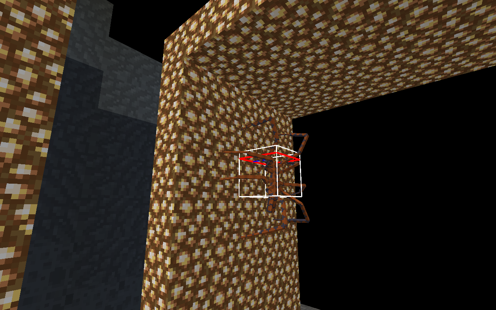
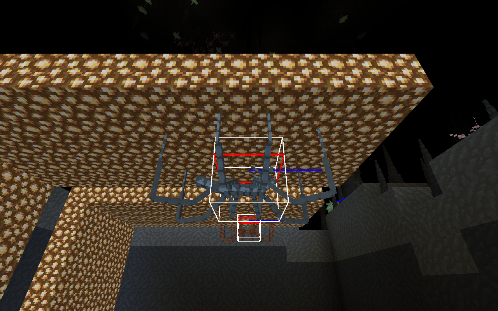

# Пауки: хитбокс и движение по поверхностям

Историческая итерация до переноса пауков на SBL/Azure. Текущий кандидат, адаптация полного корпуса и свежие проверки: [SPIDER_HYBRID_AI](SPIDER_HYBRID_AI.md). Текущий core ZIP содержит пять JAR; прежние числа/хеши ниже относятся к указанным историческим receipts.

Локальное изменение от 23.10.2026. В опубликованную alpha.16 и работающий сервер пока не включено. Версия релизного мода и подписанный каталог не менялись.

Раньше все три варианта имели коробку 1,2 × 0,7 блока при разном масштабе модели. Потолочное движение задавалось отдельной скоростью после обычной навигации по полу: цели движения, прыжки и прилипание могли мешать друг другу.

Теперь размер зависит от варианта и синхронизируется с клиентом, включая загрузку сохранённого существа:

| Вариант | Ширина и высота |
| --- | --- |
| Налётчик / SKIRMISHER | 1,20 блока |
| Засадник / LURKER | 1,70 блока |
| Плевальщик / SPITTER | 1,10 блока |

Объём одинаков по трём осям, поэтому смена стены на потолок не меняет коллизию внутри блоков. Хитбокс охватывает корпус; длинные концы ног, как у обычных пауков Minecraft, могут выходить за него.

`SpiderSurfacePath` строит ограниченный граф по прочным граням загруженных блоков. Проверяется место для всего тела и промежуточные положения между узлами. Поиск ограничен 384 посещёнными узлами и 16 блоками от начала; обычный контроллер разрешает одному пауку за игровой тик измерения выполнить основной поиск и один запасной. Повторные попытки разнесены по времени. Очередь FIFO обслуживает и поздние сущности; пропавшие запросы истекают, размер очереди ограничен. Отдельная проверка моделирует 80 соперничающих пауков. Запросов загрузки чанков и телепортации в движении нет.

На полу используется обычная наземная навигация. Во время лазания отдельная цель владеет движением и прыжками. Модель плавно меняет ориентацию относительно поверхности, а вертикальное перемещение участвует в анимации ходьбы. Потеря опоры возвращает гравитацию; после броска вниз действует задержка повторного прилипания. Потолочное управление также выполняет стрельбу плевальщика; удачный выстрел имеет общий интервал 38 тиков для наземной и поверхностной целей.

Старый сохранённый паук с коробкой 0,7 блока может после увеличения корпуса оказаться внутри крыши или угла. При первой загрузке такой записи проверяется ближайшее свободное место в пределах 1,5 блока, сначала — сохранение прежней верхней грани. Это однократная подгонка существа, а не способ движения или преследования. Блоки и игроки не перемещаются, здоровье не восстанавливается. Новая запись `SpiderBodyRevision` предотвращает повторную миграцию обычных сохранений. Свежие увеличенные варианты также проверяют исходное место появления.

## Проверка

Подробные результаты и SHA кандидата: [приёмка](verification/SPIDER_HUNTER_VERIFICATION.json), [сохранность ресурсов](verification/SPIDER_HUNTER_PRESERVATION.json).

Компонентные GameTests используют исключение для искусственного GameTestServer без DH. Они проверяют полный подъём с пола через стену на потолок для трёх вариантов, самостоятельный выбор маршрута, отсутствие прохода через блоки, удаление опоры, недоступный свод, сохранение размеров, реальную стрелу в верх корпуса и реальное попадание плевальщика с потолка. Прежние проверки боя, брони, ближнего/дальнего приоритета, траекторий и сохранения остаются отдельной группой.

Полный клиент использует 65 модовых компонентов текущей сборки, обязательный DH и настоящий `interstice:islands_v6` / revision 6. Мир создаётся заново в `.verification`; сцены подготовлены вручную кодом. В них проверяются реальные тики, совпадение клиентских размеров и поверхности с сервером, потолочный выстрел и нормальное завершение собственного integrated server. Это не прохождение Survival и не измерение ёмкости игрового сервера.

Кадры отдельной полной сборки с включённым показом хитбоксов:

Поддерживаются прочные поверхности из обычных блоков. Произвольные сложные формы декора и все возможные внешние углы не считаются принятыми по этим сценам. Для недоступного пути не используется полёт сквозь препятствие. Естественные бои нескольких игроков и субъективная оценка владельцем остаются открытыми.
