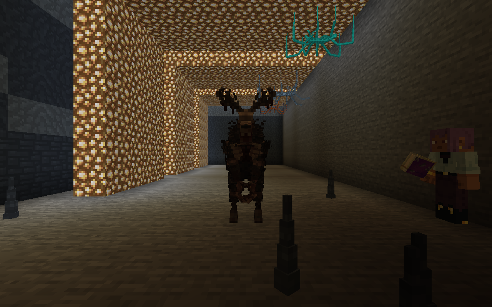
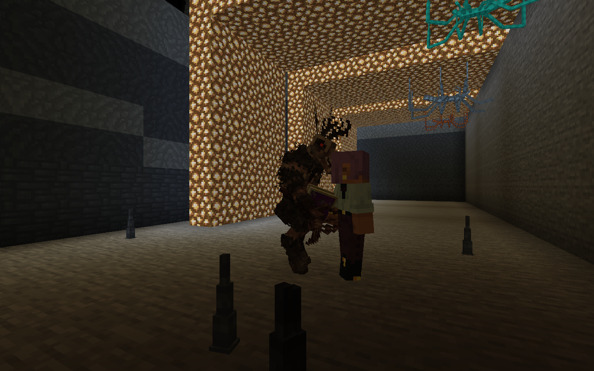

# Сводник: охотник с моделью Wendigo

Текущая настройка и свежие доказательства: [Сводник на SmartBrainLib](SMARTBRAIN_HUNTER.md). Реальный SmartBrain управляет памятью, сенсором, группами действий, движением и таймером удара.

Локальная разработка от 23.10.2026, `interstice:vault_hunter`. На работающем сервере и в подписанном модпаке этого изменения пока нет. Локальная реализация поведения и выбранной владельцем модели; естественный Survival, multiplayer и нагрузка остаются открытыми. Это не завершает все три вида фауны M22.

Сводник замечает видимого игрока в пределах 20 блоков; присевшего — в пределах 8. Невидимость, творческий режим, наблюдатель, союзная команда и недоступная для атаки цель учитываются. Зрение проверяет настоящую линию видимости.

Он слышит шаги, разрушение/установку блоков и падение снаряда в пределах 12 блоков. Через препятствие дальность ограничена 6 блоками, шерсть поглощает сигнал, приседание подавляет шаги. Источник звука даёт только точку исследования: упавший снежок не раскрывает координаты бросившего его игрока. Автоматические звуки всей техники мира намеренно не включены в этот первый прототип.

После обнаружения охотник преследует цель обычным поиском пути, используя доступные обходы. Когда видимость потеряна, ссылка на цель очищается, а запомненная позиция перестаёт обновляться. Он может подойти к доступной укрытой точке и ждать до 60 тиков, затем продолжает поиск. Память о последнем наблюдении ограничена 200 тиками, звуковая зацепка — 100. Стены он не ломает, сквозь блоки не движется и к скрытому игроку не телепортируется.

Видимый ближайший союзник может получить конечную зацепку о месте, без личности скрытого игрока и без цепного оповещения всей популяции. При здоровье до 30% сводник выбирает достижимое направление отступления с предпочтением укрытия. Отступление ограничено 100 тиками, затем следуют 160 тиков паузы. Повторное отступление блокируется на 600 тиков, чтобы раненый охотник мог вернуться в бой. Искусственного исцеления нет. После холодной загрузки сохраняются раны, но очищается временная память о противнике.

Естественное появление предусмотрено только в настоящей V6, в тёмной сухой пещере под каменной крышей, с обычным бюджетом враждебных мобов. Отдельные ограничения: 2 сводника в пределах 64 блоков, 8 в загруженном измерении. Используется один из уже существующих ограниченных пещерных слотов StrongRealmFauna, а не новый проход генерации мира. Архивные измерения и обычный мир исключены. Есть яйцо призыва и русское/английское имя; предварительная добыча — 1–2 рифтстоуна.

## Внешний вид и движения

Владелец выбрал [Wendigo автора Willmood](https://sketchfab.com/3d-models/free-wendigo-for-all-very-old-model-f0006885dac14bc690e8150902a670ef). Лицензия CC BY 4.0 подтверждена через API исходной карточки; её описание ссылается на скачанный авторский архив. Все 84 куба, 22 кости, исходные pivot/rotation/inflate и UV сохранены при переводе в vanilla ModelPart. Собственная маленькая реализация UV-куба сохраняет точные исходные UV, которые иначе смещаются при пересчёте по дробным размерам куба. PNG тела и отдельная авторская маска глаз перенесены побайтно, без новой отрисовки или перекраски. Глаза используют штатный EyesLayer. Прежние 157 PNG сохранены.

Оригинал `.bbmodel`, атрибуция и полный CC BY 4.0 находятся в `art/fauna/willmood`; лицензия/атрибуция также включены в игровой JAR. Геометрия воспроизводится `tools/import_vault_hunter.py` с проверкой SHA исходника. Источник содержит только статическую демонстрационную позу. Движения для игры — новая работа EREZ Dev: дыхание, ходьба с коленями/стопами, бег, поиск головой, ожидание в засаде, отступление и удар рукой с челюстью. Это процедурные анимации по состоянию AI; они не требуют отдельной анимационной библиотеки. В следующей итерации для поведения добавлен SmartBrainLib.

Масштаб .72; физический корпус .95 × 2.7 блока, точка зрения 1.9. В исходной проверенной позе верхние рога достигают примерно 2.65 блока. Длинные руки и боковые рога могут выходить за горизонтальный корпус, как конечности обычных мобов. Размер выбран по настоящей импортированной геометрии, а не по прежней временной модели. Своднику нужен достаточно высокий проход.

## Бой и звук

Урон 7, здоровье 36; обычная броня учитывается. Между атаками 24 тика. Удар длится 14 тиков, первые 7 — читаемый замах. В момент удара заново проверяются конкретная цель, видимость и дистанция; скрывшийся/ушедший игрок не получает дистанционный урон. Смерть, отключение AI, потеря цели и отступление отменяют ожидающий удар. Время начала/конца синхронизируется клиенту через штатные данные сущности. Продолжение удара не сохраняется в NBT.

Шесть оригинальных синтезированных звуков без сторонних записей: дыхание, обнаружение, замах, удар, ранение и смерть; есть RU/EN субтитры. `tools/generate_hunter_sounds.py` и `vault-hunter-audio.json` содержат происхождение, характеристики и хеши. Все OGG моно, 44.1 кГц, декодируются без клиппинга. Художественная оценка громкости/тембра владельцем ещё нужна. Предварительная добыча 1–2 рифтстоуна сохранена; рецепты и общая прогрессия не менялись.

[Готовые библиотеки AI и отложенный общий директор](AI_LIBRARY_REVIEW.md).

Компонентные проверки включают зрение/стену, конечную память, укрытое ожидание, звук снаряда, шерсть/приседание, обход забора через проход, локальную помощь союзника, настоящее отступление с возвращением без лечения, режимы игроков, холодную загрузку и запрет естественного появления вне V6. В полном клиенте с DH отдельно проверяются обнаружение настоящего локального игрока, неподвижный снимок после потери видимости, выбор укрытия и забывание скрытой цели. Игрок в этой подготовленной сцене защищён эффектом сопротивления: это проверка AI, а не Survival-бой.

[Подробная приёмка](verification/SPIDER_HUNTER_VERIFICATION.json).

Итог модели/боя и новые кадры: [WENDIGO_INTEGRATION](verification/WENDIGO_INTEGRATION.json). Историческая приёмка прототипа ниже не заменяет эту проверку.

Историческая приёмка модели до перехода на SBL: 27 профильных + 177 общих компонентных проверок (204), 68 проверок раннера, assemble и полный клиент с DH/V6. Свежая приёмка SBL — 211 компонентных проверок и расширенный полный клиент; см. отчёт выше.

