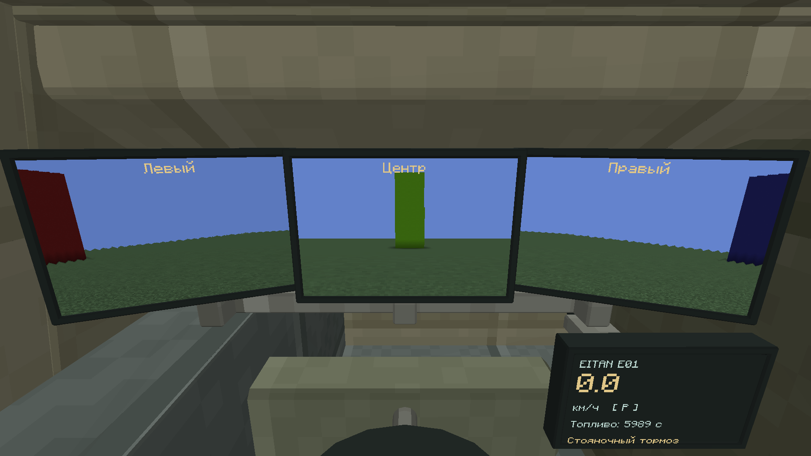
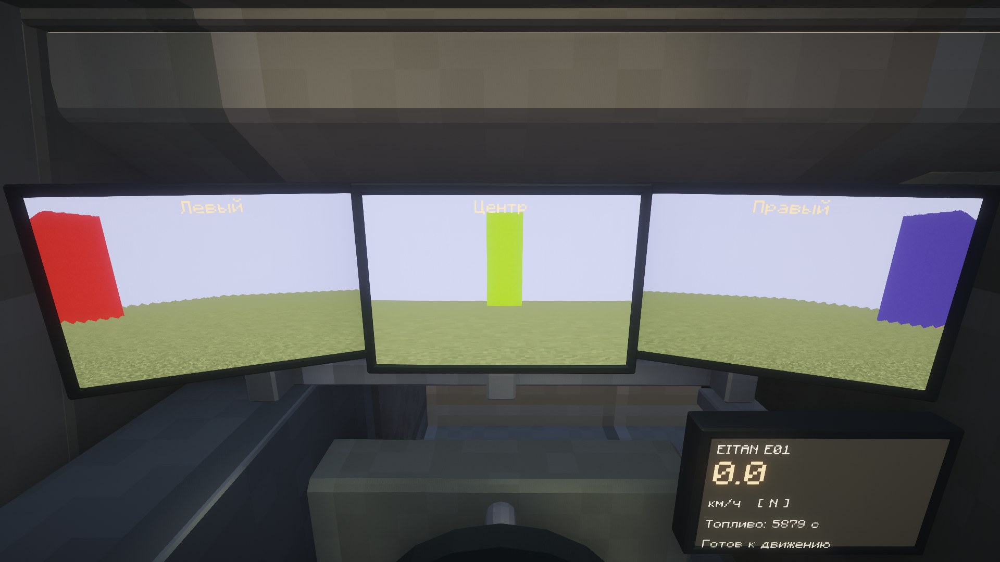
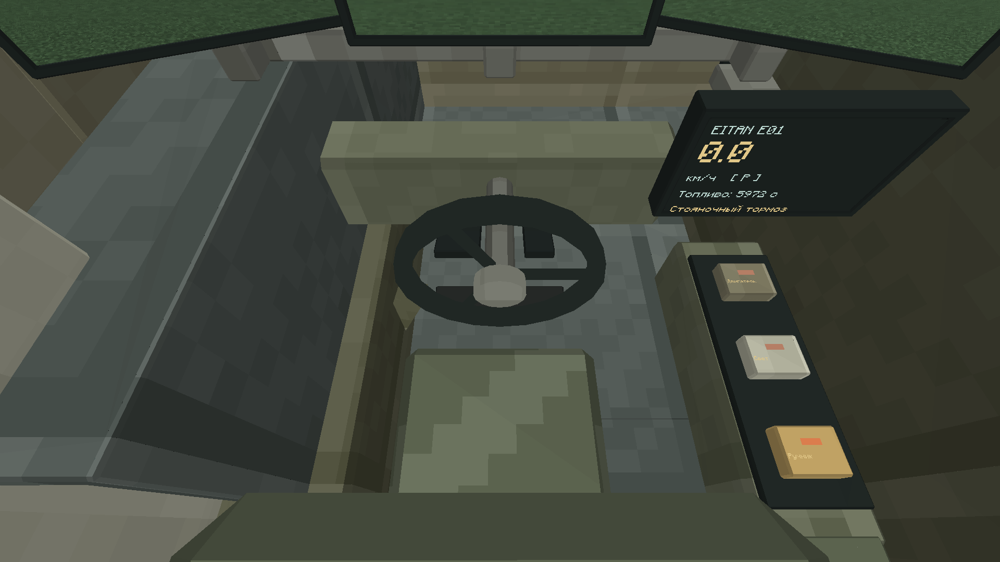
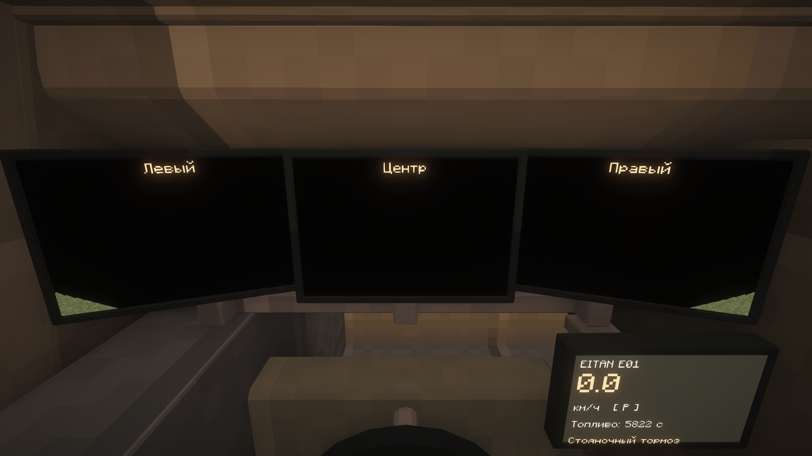
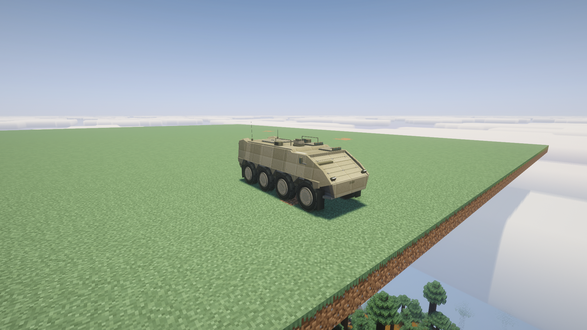
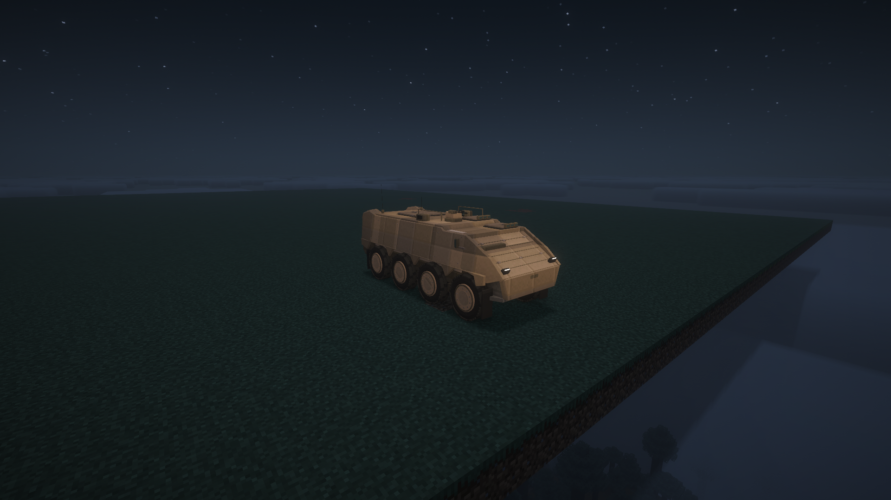
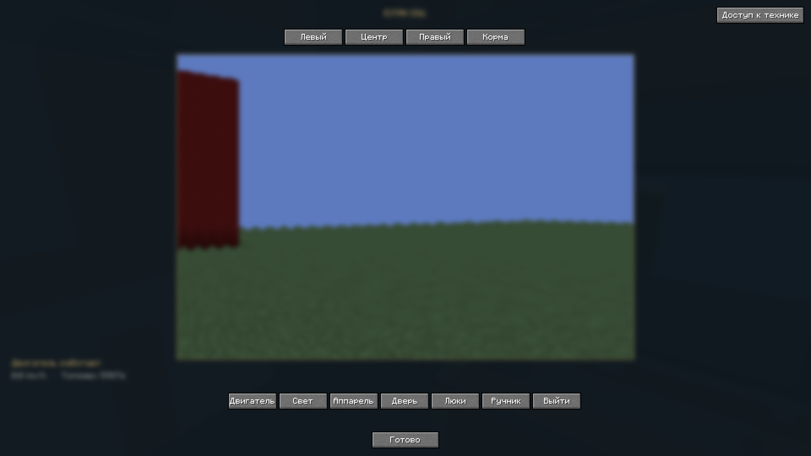
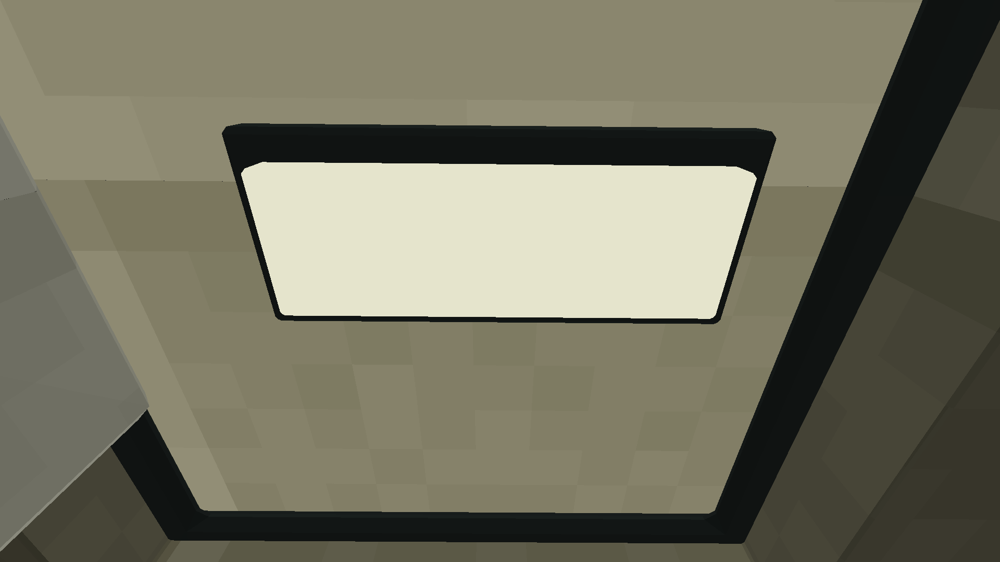

# Эйтан E01-R8 — фотографии из Minecraft

Галерея для просмотра с телефона. Все восемь фотографий настоящие, исходные PNG **1920×1080**, без перерисовки. Для полного размера нажми «Оригинал PNG» под нужным кадром.

Это локальный кандидат R8: три экрана42×28см, видеосектор150°, отдельные приборы и кнопки консоли. Игровой сервер пока использует R7.

## Кабина без шейдеров

[Оригинал PNG](https://raw.githubusercontent.com/NaveLIL/EREZCRAFT/main/docs/verification/eitan-r8/workstation-create-driver.png)

## Кабина с Complementary

[Оригинал PNG](https://raw.githubusercontent.com/NaveLIL/EREZCRAFT/main/docs/verification/eitan-r8/workstation-shader-driver.png)

## Руль, педали и кнопки

[Оригинал PNG](https://raw.githubusercontent.com/NaveLIL/EREZCRAFT/main/docs/verification/eitan-r8/workstation-create-footwell.png)

## Кабина ночью со штатным светом

[Оригинал PNG](https://raw.githubusercontent.com/NaveLIL/EREZCRAFT/main/docs/verification/eitan-r8/workstation-shader-cabin-night-lights.png)

## Внешний вид

[Оригинал PNG](https://raw.githubusercontent.com/NaveLIL/EREZCRAFT/main/docs/verification/eitan-r8/workstation-shader-exterior.png)

## Внешний вид ночью

[Оригинал PNG](https://raw.githubusercontent.com/NaveLIL/EREZCRAFT/main/docs/verification/eitan-r8/workstation-shader-exterior-night-lights.png)

## Увеличенный вид камеры

[Оригинал PNG](https://raw.githubusercontent.com/NaveLIL/EREZCRAFT/main/docs/verification/eitan-r8/workstation-create-camera-0.png)

## Закрытый водительский люк

[Оригинал PNG](https://raw.githubusercontent.com/NaveLIL/EREZCRAFT/main/docs/verification/eitan-r8/workstation-create-closed-hatch.png)
